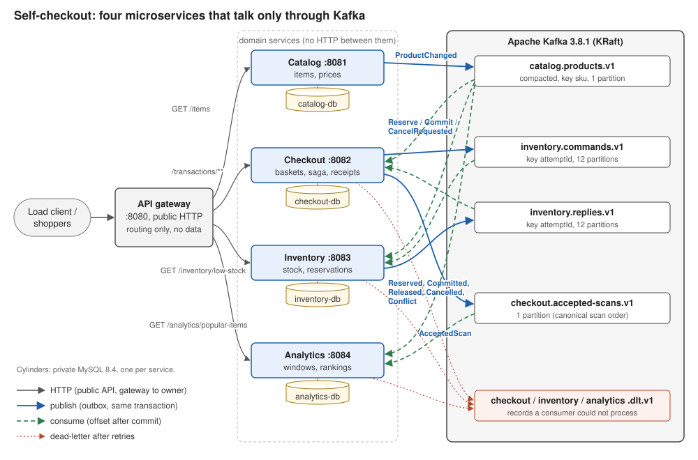
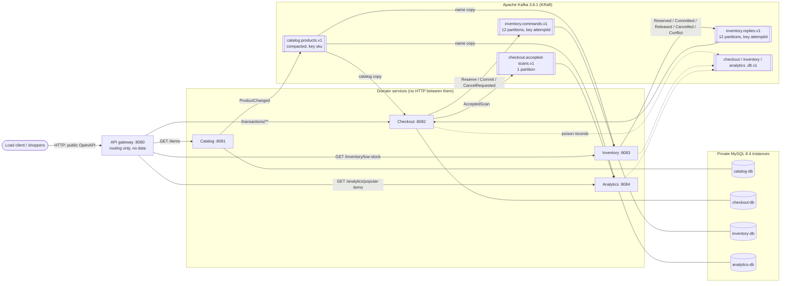

# Architecture: event-driven microservices



> **Superseded guidance.** Until feature 004 the services also called each other over internal
> HTTP: Catalog's product API and Inventory's reservation API. Feature 005
> ([spec](../../specs/005-event-driven-services/spec.md),
> [plan](../../specs/005-event-driven-services/plan.md)) removed every one of those calls. The 004
> build is kept at tag `pre-event-driven`.

Catalog, Checkout, Inventory and Analytics talk to each other **only through Kafka** (constitution
v4.0.0, Principle III). Each owns one MySQL instance that no other service can reach. The API
gateway is the single public HTTP surface. It forwards each public request to the one service that
owns it and holds no data. `NoInterServiceHttpTest` fails the build if a domain service gains an
HTTP client, a URL setting or another service's address.

## Diagram

The image above (`architecture.svg`) is drawn by hand from this Mermaid source, which GitHub also
renders inline. `scripts/render-diagram.sh` renders the source to `architecture-mermaid.svg`.



## Deployables and ports

| Deployable | Image or build | Compose service | Port inside the network | Host port |
|---|---|---|---|---|
| API gateway | `../api-gateway` | `gateway` | 8080 | `8080` (public) |
| Catalog | `../catalog-service` | `catalog` | 8081 | `127.0.0.1:8081` (operator only) |
| Checkout | `../checkout-service` | `checkout` | 8082 | `127.0.0.1:8082` (operator only) |
| Inventory | `../inventory-service` | `inventory` | 8083 | `127.0.0.1:8083` (operator only) |
| Analytics | `../analytics-service` | `analytics` | 8084 | `127.0.0.1:8084` (operator only) |
| Catalog store | `mysql:8.4` | `catalog-db` | 3306 | `127.0.0.1:3311` |
| Checkout store | `mysql:8.4` | `checkout-db` | 3306 | `127.0.0.1:3312` |
| Inventory store | `mysql:8.4` | `inventory-db` | 3306 | `127.0.0.1:3313` |
| Analytics store | `mysql:8.4` | `analytics-db` | 3306 | `127.0.0.1:3314` |
| Broker | `apache/kafka:3.8.1` (KRaft, one node) | `kafka` | 29092 | `127.0.0.1:9092` |

- **Addresses:** each domain service is configured with its own database and `KAFKA_BOOTSTRAP`
  only. The gateway's four `SERVICES_*_URL` values are the only service addresses in the
  deployment.
- **Operator ports** (`127.0.0.1:8081–8084`) serve actuator health and metrics and
  `/internal/v1/ops/**`: reconciliation exports, projection rebuild, catalog republish, and
  attempt retry. The gateway never routes `/internal/**`.
- **Readiness** covers the service's own database, the broker, and, where the service has one, its
  catalog copy (caught up with the topic). Nothing routes on readiness while services run. It
  orders startup (`depends_on … service_healthy`) and feeds monitoring.

## Data ownership

| Owner | Instance | Account | Owns |
|---|---|---|---|
| Catalog | `catalog-db` | `catalog_service` | items, prices, `catalog_publication` |
| Checkout | `checkout-db` | `checkout_service` | transactions, baskets, attempts, receipts, `command_outbox`, `accepted_scan_outbox`, catalog copy |
| Inventory | `inventory-db` | `inventory_service` | stock, reservations, sale queue, movements, `reply_outbox`, name copy |
| Analytics | `analytics-db` | `analytics_service` | ingested scans, snapshots, name copy |
| Gateway | — | — | nothing: no datasource, JDBC, Flyway or Kafka dependency |

No account can reach another instance (`PrivateStoreAccessTest`). Credentials come only from
`services.env`, which is never committed.

## Topics

| Topic | Owner (only publisher) | Consumers (group) | Key | Partitions | Cleanup |
|---|---|---|---|---|---|
| `catalog.products.v1` | Catalog | Checkout, Inventory, Analytics (`<service>-catalog-projection`) | `sku` | 1 | compact |
| `inventory.commands.v1` | Checkout | Inventory (`inventory-reservations`) | `attemptId` | 12 | delete, 7 d |
| `inventory.replies.v1` | Inventory | Checkout (`checkout-saga`) | `attemptId` | 12 | delete, 7 d |
| `checkout.accepted-scans.v1` | Checkout | Analytics (`analytics-scan-ingest`) | `transactionId` | 1 | delete, 7 d |
| `checkout.dlt.v1`, `inventory.dlt.v1`, `analytics.dlt.v1` | the consuming service | operators | original key | 1 | delete, 14 d |

Message shapes, the envelope headers (`messageId`, `messageType`, `schemaVersion`, `producer`,
`occurredAt`, `correlationId`, `causationId`) and the dead-letter rules are in the
[005 contracts](../../specs/005-event-driven-services/contracts/README.md).

## Completion: a reply-driven saga

```mermaid
sequenceDiagram
    participant C as Client
    participant G as Gateway
    participant CO as Checkout
    participant K as Kafka
    participant IN as Inventory
    C->>G: POST /transactions/{id}/complete
    G->>CO: forward (HTTP, single owner)
    CO->>CO: tx: freeze basket, attempt RESERVING, outbox ReserveRequested
    CO->>K: inventory.commands.v1 ReserveRequested (after commit)
    K->>IN: ReserveRequested
    IN->>IN: tx: reserve lines, reply_outbox Reserved
    IN->>K: inventory.replies.v1 Reserved
    K->>CO: Reserved
    CO->>CO: tx: COMMITTING + grants, outbox CommitRequested
    CO->>K: CommitRequested
    K->>IN: CommitRequested
    IN->>IN: tx: COMMITTED, sale_queue, reply_outbox Committed
    IN->>K: Committed
    K->>CO: Committed
    CO->>CO: tx: FINALIZED, receipt, basket; wake the request
    CO-->>G: 200 receipt
    G-->>C: 200 receipt
```

- **Same-transaction outboxes:** every state change writes its outgoing message in the same
  local transaction (`command_outbox` in Checkout, `reply_outbox` in Inventory). A sender thread
  publishes it right after commit, sending older unsent rows of the same attempt first. A
  one-second sweep resends anything still unsent after two seconds.
- **Idempotent receivers:** Inventory's commands are keyed by `attemptId`, so a repeat returns
  the stored outcome. Checkout applies a reply only as a conditional transition from the
  expected state, and a stale or repeated reply changes nothing.
- **Waiting:** the request waits for the outcome up to 5 s. Past that it returns
  `503 SERVICE_UNAVAILABLE`, and the attempt keeps settling in the background.
- **Recovery:** an attempt that has had no reply by its `next_retry_at` gets its current command
  resent with backoff (250 ms doubling, 5 s cap). A `RESERVING` attempt older than 30 s is
  cancelled. A `COMMITTING` attempt is only ever committed. After 20 sends the attempt is flagged
  for operators.

## Catalog copies

Catalog publishes every item at each catalog version from a version-based outbox
(`catalog_publication`). Each consumer keeps its copy and the topic offset it has applied in
one transaction, seeks from that offset on start, and reports not ready until it has caught up
with the end offset it saw at assignment. A scan of a SKU the copy doesn't hold yet returns 503
while the copy is replaying, and the unknown-item error once it has caught up.
`POST /internal/v1/ops/catalog-projection/rebuild` replays the topic from the beginning.

## Analytics pipeline: `ingest → window → rank-and-publish`

Unchanged from 004. Each batch of accepted scans runs the three filters in one Analytics
transaction:
1. **Ingest** records each `eventId` once and assigns the canonical sequence.
2. **Window** emits the latest 1,000 scans at every 500.
3. **Rank and publish** ranks by count, then SKU, using names from the event-built copy, and
   moves the published-snapshot pointer.

Unreadable records are recorded in `ingest_rejections` and copied to `analytics.dlt.v1`.

## Reconciliation

`scripts/reconcile.sh` reads each owner's export over its operator port and checks R-1 to R-6
from 004: stock and receipts agree, and no unresolved attempt or open reservation is left. It
adds three 005 checks:
- **R-7:** every outbox is drained.
- **R-8:** every dead-letter topic is empty.
- **R-9:** the catalog is fully published, and every copy is at its version.
