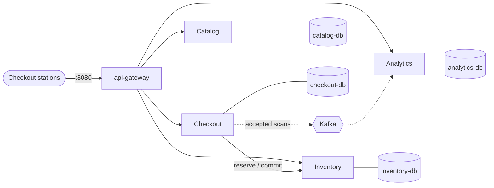
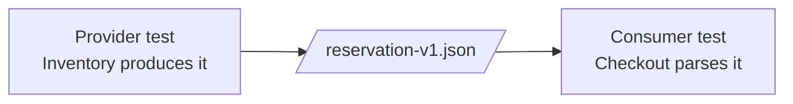
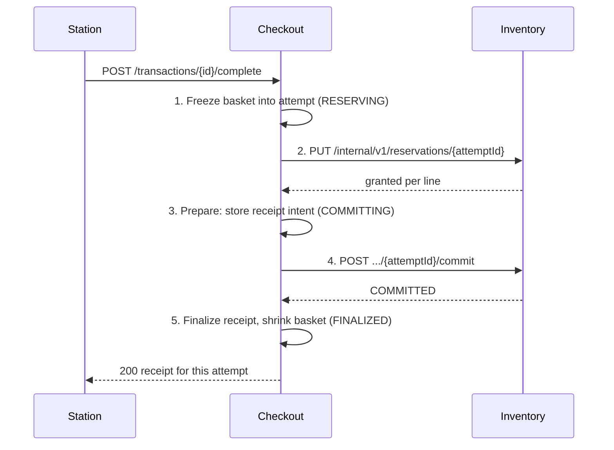
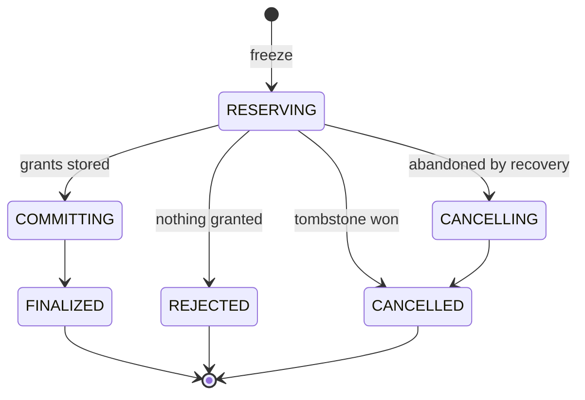
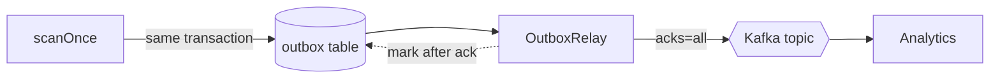
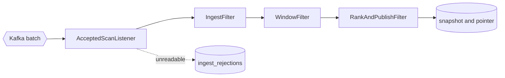

# Self-Checkout Domain Services

## A codewalk

<div class="pt-8 opacity-75">

One checkout, followed through the code from the gateway to the analytics view

`domain-services/` · branch `microservice-new`

</div>

---

# Route of the Tour

<div class="grid grid-cols-5 gap-3 pt-2">
  <div class="stop"><b>1</b>Repository and stack</div>
  <div class="stop"><b>2</b>Shared contracts</div>
  <div class="stop"><b>3</b>Gateway</div>
  <div class="stop"><b>4</b>Catalog</div>
  <div class="stop"><b>5</b>Scan</div>
  <div class="stop"><b>6</b>Completion saga</div>
  <div class="stop"><b>7</b>Recovery</div>
  <div class="stop"><b>8</b>Outbox and Kafka</div>
  <div class="stop"><b>9</b>Analytics</div>
  <div class="stop"><b>10</b>Tests and evidence</div>
</div>

<v-clicks class="pt-6">

- Same public API and the same load client as the earlier architectures
- Every stop is a package or a file you can open

</v-clicks>

<!--
Set expectations: this is a walk through the code, not a history of how it was built.
-->

---
layout: two-cols
---

# Repository Map

```text
domain-services/
├── pom.xml              multi-module build
├── service-contracts/   the only shared code
├── api-gateway/
├── catalog-service/
├── checkout-service/
├── inventory-service/
├── analytics-service/
├── integration-tests/   tests against the stack
└── deployment/          compose, scripts, reports
```

::right::

<div class="pl-6 pt-14">

**One module per deployable**

Each service builds to its own jar and image.

**Packages by concern**

Inside a service: `api`, `internal`, `ops`, then `scan`, `completion`, `recovery`, `outbox`, `catalog`, `health`.

**Rule**

Services depend on `service-contracts`, never on each other.

</div>

---

# Running the Stack: Topology



<div class="text-sm opacity-80">

Ten containers from `deployment/docker-compose.yml`. Only port 8080 is public; operator and database ports bind to `127.0.0.1`.

</div>

<!--
Plain version: the project is ten pieces that must run together. Compose is the recipe that starts them all with one command.
-->

---

# Running the Stack: Commands and Config

<div class="grid grid-cols-2 gap-6">
<div>

**Scripts** <span class="path">deployment/scripts/</span>

```bash
# build, start, wait for readiness
start-services.sh

# wipe every volume, rebuild, restart
reset.sh

# databases, Kafka and services healthy?
check-readiness.sh

# full validation run
validate-all.sh
```

</div>
<div>

**One private store per service** <span class="path">docker-compose.yml</span>

```yaml
checkout-db:
  image: mysql:8.4
  environment:
    MYSQL_DATABASE: ${CHECKOUT_DB_NAME:-checkout}
    MYSQL_USER: ${CHECKOUT_DB_USERNAME:-checkout_service}
    MYSQL_PASSWORD: ${CHECKOUT_DB_PASSWORD:?...}
  ports: ["127.0.0.1:3312:3306"]
```

- Passwords come from `services.env`, never committed
- Pools, timeouts and recovery settings live in each `application.yml`

</div>
</div>

---

# Shared Contracts: The Message Shapes

<div class="grid grid-cols-2 gap-6">
<div>

```java
// inventory/v1: body of PUT .../reservations/{attemptId}
@JsonIgnoreProperties(ignoreUnknown = true)
public record ReserveRequestV1(
    String transactionId,
    List<ReserveLineV1> lines) { }
```

```java
// events/v1: value on topic checkout.accepted-scans.v1
public record AcceptedScanV1(
    int schemaVersion,
    String eventId,        // deduplication key
    String eventType,
    String transactionId,
    String stationId,
    String sku,
    Instant acceptedAt,
    long outboxId) { }
```

</div>
<div>

<v-clicks>

- Services never call each other's code; they exchange these messages
- Each shape is defined **once**, and both sides use it
- `v1` in the package lets a provider add `v2` without forcing everyone to upgrade at once
- `ignoreUnknown = true`: an added field does not break an older reader

</v-clicks>

</div>
</div>

<!--
Plain version: this module is the rulebook for messages between services.
-->

---

# Shared Contracts: Fixtures Keep Everyone Honest



<div class="grid grid-cols-2 gap-6 pt-4">
<div>

**Canonical samples** <span class="path">service-contracts/src/test/resources/fixtures/</span>

- `catalog-version-v1.json`, `product-v1.json`, `product-page-v1.json`
- `reserve-request-v1.json`, `reservation-v1.json`
- `accepted-scan-v1.json`

</div>
<div>

**Tests on both sides**

- `FixtureCompatibilityTest` in `service-contracts`
- Provider: `ReservationContractTest`, `CatalogInternalContractTest`
- Consumer: `InventoryClientContractTest`, `CatalogClientContractTest`

An accidental format change fails a build before it ships.

</div>
</div>

---

# Entry Point: `api-gateway` Routes

<span class="path">api-gateway/.../gateway/CheckoutRouteHandler.java</span>

```java {all|4-6|7-8}
@PostMapping("/{transactionId}/items")
ResponseEntity<byte[]> scan(@PathVariable String transactionId, @RequestBody(required = false) byte[] body,
                            @RequestHeader(value = "Content-Type", required = false) String contentType) {
  if (GatewayValidation.missingText(body, "sku")) {
    return GatewayValidation.badRequest("MISSING_SKU", "sku is required.");
  }
  return proxy.forward(UpstreamProxy.Service.CHECKOUT, HttpMethod.POST,
      "/transactions/" + transactionId + "/items", body, contentType);
}
```

<v-clicks>

- `CheckoutRouteHandler`: start, scan, get and complete, all forwarded to Checkout
- `ReadModelRouteHandler`: `/items`, `/inventory/low-stock`, `/analytics/popular-items`, forwarded unchanged
- `GatewayValidation`: only the field checks the gateway has always made

</v-clicks>

---

# Entry Point: `UpstreamProxy`

```java {all|3|8-11|12-14}
public ResponseEntity<byte[]> forward(Service service, HttpMethod method, String pathAndQuery,
                                      byte[] body, String contentType) {
  HttpRequest.Builder request = HttpRequest.newBuilder(URI.create(baseUrls.get(service) + pathAndQuery))
      .timeout(READ_TIMEOUT);   // 8 s: longer than Checkout's 5 s completion deadline
  // ... body or no body ...
  try {
    HttpResponse<byte[]> response = http.send(request.build(), HttpResponse.BodyHandlers.ofByteArray());
    ResponseEntity.BodyBuilder out = ResponseEntity.status(response.statusCode());
    response.headers().firstValue(HttpHeaders.CONTENT_TYPE)
        .ifPresent(type -> out.header(HttpHeaders.CONTENT_TYPE, type));
    return out.body(response.body());
  } catch (IOException e) {
    return unavailable(service);   // refused, reset or timed out → 503 SERVICE_UNAVAILABLE
  }
}
```

<v-clicks>

- Status, content type and body pass through, **including every 4xx**, so domain error codes reach the client
- What the gateway deliberately lacks: no datasource, no Kafka, no `/internal/**` routes

</v-clicks>

---

# Catalog Service and Its Projections

<div class="grid grid-cols-2 gap-6">
<div>

**Internal API** <span class="path">CatalogInternalController</span>

- `GET /internal/v1/catalog-version`
- `GET /internal/v1/products` (paged)
- Read-only, safe to retry, not routed by the gateway
- Storage: `CatalogRepository`, `V1__catalog.sql`, `V2__seed_catalog.sql`

</div>
<div>

**Copies kept by consumers**

| Service | Projection | Holds |
|---|---|---|
| Checkout | `CatalogProjection` | names and prices |
| Inventory | `CatalogNameProjection` | names |
| Analytics | `CatalogNameProjection` | names |

</div>
</div>

<v-click>

**Loader policy** (`CatalogProjectionLoader`): probe the version every 15 s, reload everything when it changes, and treat the copy as `CURRENT` while the last good check is at most 60 s old. Otherwise it is `STALE`, or `EMPTY` before the first load.

</v-click>

---

# Scan Path: Resolving the Product

<span class="path">checkout-service/.../scan/ProductLookup.java</span>

```java {all|2-3|4|5-12}
public Result lookup(String sku) {
  var hit = projection.find(sku);
  if (hit.isPresent()) return new Accept(hit.get().name(), hit.get().priceCents());
  if (projection.state() == CatalogProjection.State.CURRENT) return new UnknownSku();
  return switch (catalog.lookup(sku)) {
    case CatalogClient.Found found -> {
      projection.upsertSingle(found.product());
      yield new Accept(found.product().name(), found.product().priceCents());
    }
    case CatalogClient.NotFound notFound -> new UnknownSku();
    case CatalogClient.Unavailable unavailable -> new Unverifiable();   // 503, never "not found"
  };
}
```

<v-clicks>

- A hit is accepted whatever the projection's state
- A miss means `404 SKU_NOT_FOUND` only while the copy is current
- Called **before** any transaction opens, so no remote call ever holds a row lock

</v-clicks>

---

# Scan Path: One Local Transaction

<span class="path">checkout-service/.../scan/ScanService.java · scanOnce</span>

```java {all|1-3|4-6|7-9|10-12}
// FOR SHARE serializes with the completion freeze (FOR UPDATE)
String[] locked = db.query("SELECT status, active_attempt_id, station_id FROM checkout_transactions "
    + "WHERE transaction_id = ? FOR SHARE", ...);
if (locked == null) throw ApiException.transactionNotFound(transactionId);
if (!"OPEN".equals(locked[0])) throw ApiException.transactionNotOpen(transactionId);
if (locked[1] != null) throw ApiException.transactionBusy(transactionId);      // 409 TRANSACTION_BUSY
// Price and name are captured at the first scan of a SKU and never re-priced
db.update("INSERT INTO basket_lines (...) VALUES (?, ?, 1, ?, ?) "
    + "ON DUPLICATE KEY UPDATE quantity = quantity + 1", ...);
// The accepted-scan event commits with the basket change or not at all
db.update("INSERT INTO accepted_scan_outbox (event_id, transaction_id, station_id, sku, accepted_at) "
    + "VALUES (?, ?, ?, ?, CURRENT_TIMESTAMP(6))", UuidV7.next(), ...);
```

<v-click>

Lock victims are retried up to 8 times with backoff, counted in `checkout.db.retries`. A scan never reserves or checks stock.

</v-click>

---

# Completion: The Saga at a Glance

<div class="grid grid-cols-[3fr_2fr] gap-6">
<div>



</div>
<div class="pt-4">

<v-clicks>

- Five local transactions in two private databases; no transaction spans both
- Steps 2 and 4 are HTTP calls keyed by `attemptId`, so they repeat safely
- No remote call is made while a local transaction is open
- Partial stock: only granted units are bought; the rest stay in the basket

</v-clicks>

</div>
</div>

---

# Completion: The Attempt State Machine

<div class="grid grid-cols-2 gap-6">
<div>



</div>
<div>

<span class="path">checkout-service/.../completion/AttemptState.java</span>

```java
public enum AttemptState {
  RESERVING, COMMITTING, CANCELLING,
  FINALIZED, REJECTED, CANCELLED;
}
```

<v-clicks>

- `COMMITTING` is the point of no return: from here the attempt only moves forward
- `REJECTED` answers `409 INSUFFICIENT_STOCK` with the basket unchanged
- Only `RESERVING` may be cancelled

</v-clicks>

</div>
</div>

---

# Completion: Freeze or Join

<span class="path">checkout-service/.../completion/CompletionService.java · freeze</span>

```java {all|2-4|5|6-7|8-10}
private Freeze freeze(String transactionId, String owner) {
  CompletionAttemptRepository.TransactionLock tx = attempts.lockTransaction(transactionId)
      .orElseThrow(() -> ApiException.transactionNotFound(transactionId));
  if (!"OPEN".equals(tx.status())) throw ApiException.transactionNotOpen(transactionId);
  if (tx.activeAttemptId() != null) return new Freeze(tx.activeAttemptId(), true, ...);   // join it
  List<AttemptLine> basket = attempts.basketLines(transactionId);
  if (basket.isEmpty()) throw ApiException.emptyBasket(transactionId);
  String attemptId = UuidV7.next();
  attempts.insertAttemptWithLines(attemptId, transactionId, basket, now, owner,
      now.plus(recovery.leaseDuration()));                                                 // leased to this request
  ...
}
```

<v-clicks>

- A second `complete` call joins the running attempt instead of buying twice
- Then `complete` drives the saga **outside** any transaction, within a 5 s deadline

</v-clicks>

---

# Completion: `AttemptDriver`

<span class="path">checkout-service/.../completion/AttemptDriver.java · run</span>

<div class="grid grid-cols-[3fr_2fr] gap-6">
<div>

```java {all|2-3|5-8|10-13}
while (true) {
  if (terminal(attempt.state()) != null) return ...;
  if (!clock.instant().isBefore(deadline)) return UNRESOLVED;
  try {
    attempt = switch (attempt.state()) {
      case RESERVING -> reserveStep(attempt, deadline);
      case COMMITTING -> commitStep(attempt, deadline);
      case CANCELLING -> cancelStep(attempt, deadline); };
  } catch (InventoryUnavailableException unknownOutcome) {
    // Not a cancellation: the attempt keeps its state
    // and recovery repeats the same command.
    attempts.recordStepFailure(attemptId, ..., retryAt, failedAt);
    return UNRESOLVED;
  }
}
```

<div class="text-xs opacity-60 pt-1">Simplified from <code>run</code>; the real loop also handles a lost conditional update and the deadline per call.</div>

</div>
<div>

<v-clicks>

- Every local write is a conditional update on the expected state; losing it means another driver moved on
- `HttpInventoryClient`: 300 ms connect, 1.5 s read
- `UNRESOLVED` → `503`, and recovery carries on
- `ReceiptAssembler`: a receipt for **this attempt only**, in exact cents

</v-clicks>

</div>
</div>

---

# Inventory: Reserve Without Holding Hot Rows

<span class="path">inventory-service/.../reservation/ReservationRepository.java · reserveUpTo</span>

```sql
UPDATE inventory_positions
SET reserved_stock = reserved_stock
    + LAST_INSERT_ID(LEAST(?, GREATEST(physical_stock - reserved_stock, 0)))
WHERE sku = ?
```

<v-clicks>

- One conditional single-row update per SKU grants `min(requested, available)`
- `LAST_INSERT_ID(...)` returns the grant without a second round trip
- SKUs are taken in **descending** order, the same order everywhere, to avoid deadlocks; `withLockRetries` covers the rest
- No `FOR UPDATE` read first: each hot row is held only briefly
- Zero granted in total → the reservation is `RELEASED` and Checkout rejects the attempt

</v-clicks>

---

# Inventory: Idempotent Commands and `SaleApplier`

<div class="grid grid-cols-2 gap-6">
<div>

**Every command is keyed by `attemptId`** <span class="path">ReservationService</span>

| Command | Repeat returns | Guard |
|---|---|---|
| `reserve` | stored outcome | `RESERVATION_MISMATCH` on different lines |
| `commit` | `COMMITTED` | not after release or cancel |
| `cancel` | `RELEASED` / `CANCELLED` | `RESERVATION_COMMITTED` after commit |

Cancel on an unknown id writes a **tombstone**, so a late reserve holds nothing.

</div>
<div>

**Commit only queues the sale** <span class="path">SaleApplier</span>

```java
SELECT ... FROM sale_queue ORDER BY queue_id
LIMIT ? FOR UPDATE SKIP LOCKED
```

- About every 100 ms, one update per SKU per batch moves reserved → physical stock
- Writes the `SALE` movements, deletes the queue rows
- Many completions of a hot SKU cost one row lock

</div>
</div>

---

# Recovery: `RecoveryWorker`

<span class="path">checkout-service/.../recovery/RecoveryWorker.java · recover</span>

<div class="grid grid-cols-[3fr_2fr] gap-6">
<div>

```java {all|1-2|3-7|8|9-11}
if (!attempts.acquireLease(attemptId, owner, ...))
  return;   // another driver (a request or replica) has it
if (step == RESERVING && attempt.stepFailures() > 0
    && attempt.createdAt().isBefore(now.minus(recovery.cancelAfter()))) {
  // Only before the receipt intent is durable may it be abandoned
  attempts.transition(attemptId, RESERVING, CANCELLING, now);
}
driver.drive(attemptId, now.plus(completion.requestDeadline()), owner);
if (!after.state().isTerminal()
    && after.stepFailures() >= recovery.attentionAfter())
  attempts.markNeedsAttention(attemptId, "... still retrying: " + ..., flaggedAt);
```

- Same `AttemptDriver` as a request, so recovery runs the same steps
- `COMMITTING` attempts only ever move forward

</div>
<div>

| Setting | Default |
|---|---|
| `scan-interval` | 1 s |
| `lease-duration` | 10 s |
| backoff | 250 ms → 5 s |
| `cancel-after` | 30 s |
| `attention-after` | 20 failures |

On shutdown, `RecoveryLifecycle` stops picking up attempts and hands its leases back.

</div>
</div>

---

# Fault Injection

| Saga step | Checkpoint after it | Failure it simulates |
|---|---|---|
| Freeze | `AFTER_FREEZE` | crash before Inventory is called |
| Reserve | `AFTER_RESERVE_RESPONSE` | crash with stock held, no intent stored |
| Prepare | `AFTER_PREPARE` | crash after the point of no return |
| Commit | `AFTER_COMMIT_RESPONSE` | sale committed, receipt not yet finalized |

<div class="grid grid-cols-2 gap-6 pt-4">
<div>

**In the code**

- `FaultInjector.checkpoint(FaultPoint)` at each step boundary
- `NoopFaultInjector` in normal runs
- `HaltingFaultInjector` and `FaultController` only under the `fault-injection` profile

</div>
<div>

**In the stack**

- `docker-compose.faults.yml` puts Toxiproxy between Checkout and Inventory
- Used only by the recovery tests (`-Dstack.faults=true`), never by measured runs

</div>
</div>

---

# Accepted Scans: Outbox to Kafka



<v-clicks>

- One relay per Checkout database: a MySQL named lock (`GET_LOCK`) on a dedicated connection
- Kafka down: rows wait in the outbox and scans keep succeeding
- A crash between ack and mark republishes the same `eventId`, which Analytics ignores
- Published rows are purged after 24 h; `OutboxHealthIndicator` reports the pending count

</v-clicks>

---

# `OutboxRelay.publishOnce`

<span class="path">checkout-service/.../outbox/OutboxRelay.java</span>

```java {all|2-4|5-6|7-14|15-18}
List<OutboxRow> rows = db.query(
    "SELECT outbox_id, event_id, transaction_id, station_id, sku, accepted_at FROM accepted_scan_outbox "
        + "WHERE published_at IS NULL ORDER BY outbox_id LIMIT ?", ..., BATCH);
if (rows.isEmpty()) return 0;
for (OutboxRow row : rows) sends.add(kafka.send(mapper.record(row)));
kafka.flush();
for (int i = 0; i < rows.size(); i++) {
  try {
    sends.get(i).get(15, TimeUnit.SECONDS);
    acknowledged.add(rows.get(i).outboxId());
  } catch (Exception e) {
    if (failure == null) failure = new IllegalStateException("broker did not acknowledge ...", e);
  }
}
if (!acknowledged.isEmpty()) {
  db.update("UPDATE accepted_scan_outbox SET published_at = CURRENT_TIMESTAMP(6) WHERE outbox_id IN (" + ids + ")");
}
if (failure != null) throw failure;   // the loop backs off and retries
```

---

# Analytics Pipeline: Pipes and Filters

<span class="path">analytics-service/.../ingest/ScanPipeline.java</span>

```java
public void process(List<AcceptedScanV1> events) {
  rankAndPublish.publish(window.windows(ingest.ingest(events)));
}
```



<v-click>

All three filters run in **one** Analytics transaction. Offsets are acknowledged only after it commits; a failed batch is sought back and redelivered (`KafkaConsumerConfig`).

</v-click>

---

# Analytics Pipeline: The Three Filters

<div class="grid grid-cols-3 gap-4">
<div>

**`IngestFilter`**

```java
SELECT last_sequence
FROM ingest_state
WHERE id = 1 FOR UPDATE
```

- Records each `eventId` once
- Next canonical sequence number under the lock
- Replays and duplicates change nothing

</div>
<div>

**`WindowFilter`**

```java
Window window(long end) {
  return new Window(
    Math.max(1, end - (SIZE - 1)),
    end);
}
```

- Latest 1,000 scans
- A new window every 500 scans, plus one at sequence 1

</div>
<div>

**`RankAndPublishFilter`**

- Count by SKU in the window
- Rank by count, then SKU
- Write snapshot rows, **then** move the pointer
- A missing name fails the batch rather than publishing a SKU as a name

</div>
</div>

---

# Read Models

<div class="grid grid-cols-2 gap-6">
<div>

**Popular items** <span class="path">analytics-service</span>

- `PopularItemsController`: the pointer and its snapshot in one read-only transaction
- Readers see a complete old or new ranking, never a mix
- Empty ranking before the first publication
- `IngestStatusController` and `ConsumerLag`: `/internal/v1/ops/ingest-status`

</div>
<div>

**Low stock** <span class="path">inventory-service</span>

- `LowStockController` → `LowStockRepository.below(threshold)`
- Physical stock only; reservations never counted
- Names from `CatalogNameProjection`; `503` when an alerted SKU has no known name
- `InventoryOpsController` for reconciliation and diagnostics

</div>
</div>

---

# Data Ownership in Code

<div class="grid grid-cols-2 gap-6">
<div>

**Migrations per service**

- Flyway scripts in each module's `src/main/resources/db/migration`
- The version history shows the move from shared objects to private stores

**Removing what was shared**

```sql
-- catalog   V3__private_store.sql
DROP VIEW active_items;
-- inventory V5__private_store.sql
DROP PROCEDURE IF EXISTS fulfill_checkout;
DROP VIEW low_stock;
-- analytics V3__private_store.sql
DROP VIEW published_popularity;
```

</div>
<div>

**Readiness**

- Covers only the service's own database
- Each service starts and becomes ready with every other service stopped

**Dependency health as detail**

- `InventoryHealthIndicator`, `KafkaHealthIndicator`
- `CatalogProjectionHealthIndicator`, `OutboxHealthIndicator`

**Error model**

- Each service has its own `ApiError`, `ApiException`, `ApiExceptionHandler`

</div>
</div>

---

# Tests: Four Layers

| Layer | Where | Examples |
|---|---|---|
| Unit | each module | `AttemptDriverTest` (with `FakeInventory`, `InMemoryAttemptRepository`), `RecoveryWorkerTest`, `WindowFilterTest`, `UuidV7Test` |
| Testcontainers | each module | `ReservationServiceIT`, `FinalizeIT`, `OutboxRelayIT`, `ScanIngestIT` |
| Contract | each module | `ReservationContractTest`, `InventoryClientContractTest`, `CheckoutContractTest` |
| System | `integration-tests` | `completion/`, `analytics/`, `deployment/`, `contract/`, `boundaries/` |

<div class="grid grid-cols-2 gap-6 pt-3 text-sm">
<div>

**Completion scenarios:** `PartialFulfillmentTest`, `ConcurrentLastUnitTest` (fifty stations, one unit), `LostResponseTest`, `CancelCommitRaceTest`, `BusyScanTest`

</div>
<div>

**Helpers** in `support/`: `Stack`, `PublicApi`, `ScanDriver`, `Faults`, `Reconciliation`

</div>
</div>

---

# Tests: Architecture Rules as Code

<div class="grid grid-cols-2 gap-6">
<div>

**`ModuleBoundaryTest`** (static checks)

- `domainModulesDependOnNoOtherDomainModule`
- `noServiceSqlNamesAnotherServicesSchema`
- `serviceContractsHasNoPersistenceTypes`
- `gatewayHasNoPersistenceOrBrokerDependency`
- `gatewayContainsOnlyRoutingAndTranslationClasses`

</div>
<div>

**`PrivateStoreAccessTest`** (against the stack)

- Tries every service account against every database instance
- Each owner sees only its own database
- Looks for the old cross-store views and procedure

**`IndependentStartupTest`**

- Each service becomes ready with the others stopped

</div>
</div>

---

# Operations and Evidence

<div class="grid grid-cols-2 gap-6">
<div>

**Operator endpoints** (loopback ports only)

```text
GET  /internal/v1/ops/completion-attempts
GET  /internal/v1/ops/completion-attempts/{id}
POST /internal/v1/ops/completion-attempts/{id}/retry
GET  /internal/v1/ops/reconciliation-export
GET  /internal/v1/ops/ingest-status
```

**Measurement**

- `run-measurement.sh`, `capture-observations.sh`, `compare-reports.sh`
- Outputs in `deployment/reports/`

</div>
<div>

**Reconciliation** <span class="path">scripts/reconcile.sh</span>

| Check | Rule |
|---|---|
| R-1 | physical ≥ reserved ≥ 0 |
| R-2 | no `RESERVED` reservation left |
| R-3 | no unresolved attempt or freeze flag |
| R-4 | initial − physical = receipt quantity |
| R-5 | committed reservations = finalized attempts |
| R-6 | accepted scans = ingested scans |

</div>
</div>

---
layout: center
class: text-center
---

# Questions

<div class="pt-6 opacity-75">

Start at `domain-services/deployment/README.md` and `ARCHITECTURE.md`

</div>
