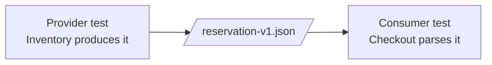
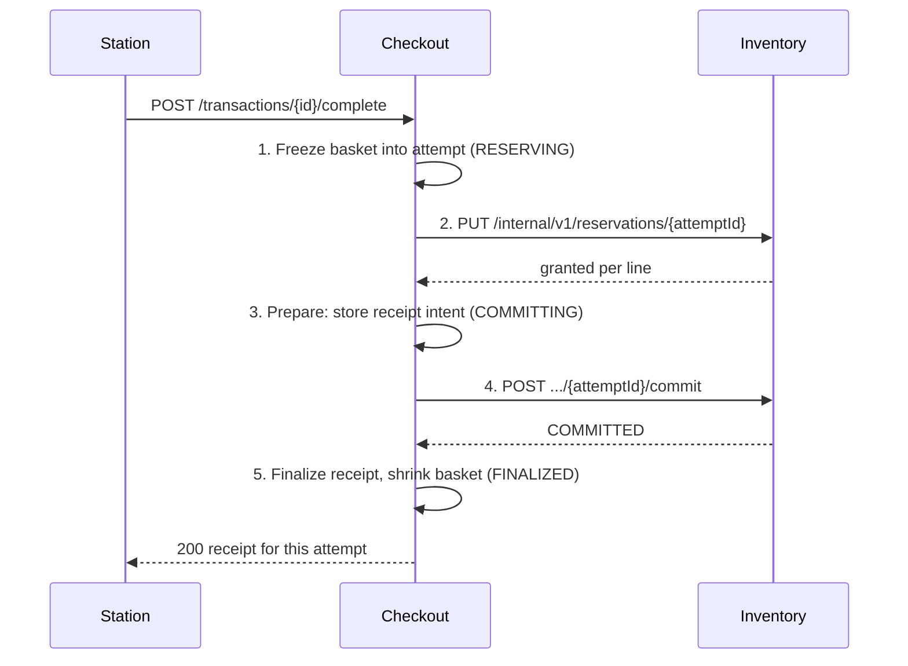
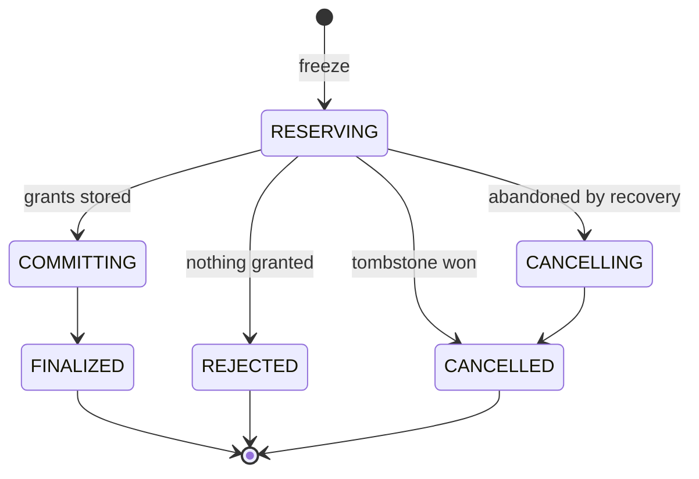
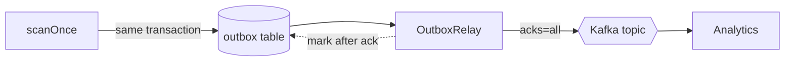
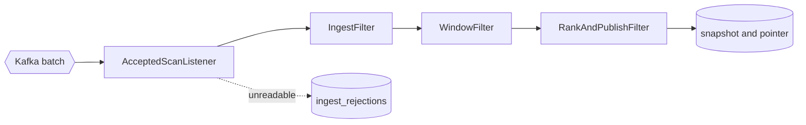

# Self-Checkout Domain Services

## A codewalk

<div class="pt-8 opacity-75">

One checkout, followed through the code from the gateway to the analytics view

`domain-services/` · branch `microservice-new`

</div>

<!--
Today I'm walking through the code of the domain-services version of the self-checkout system.

Rather than tell the story of how it was built, I'll follow one checkout. A station starts a transaction, scans items and completes the purchase, and those scans end up in the popular-items ranking. At each step I'll open the class that does the work.

Everything I show is in the domain-services folder on the microservice-new branch.
-->

---

# Route of the Tour

<div class="grid grid-cols-5 gap-3 pt-2">
  <div class="stop"><b>1</b>Repository and stack</div>
  <div class="stop"><b>2</b>Shared contracts</div>
  <div class="stop"><b>3</b>Gateway</div>
  <div class="stop"><b>4</b>Catalog</div>
  <div class="stop"><b>5</b>Scan</div>
  <div class="stop"><b>6</b>Completion saga</div>
  <div class="stop"><b>7</b>Recovery</div>
  <div class="stop"><b>8</b>Outbox and Kafka</div>
  <div class="stop"><b>9</b>Analytics</div>
  <div class="stop"><b>10</b>Tests and evidence</div>
</div>

<v-clicks class="pt-6">

- Same public API and the same load client as the earlier architectures
- Every stop is a package or a file you can open

</v-clicks>

<!--
This is the route. First, how the repository is laid out and how to run it. Then the shared contracts, which are the only code the services share.

After that we follow a request: the gateway, Catalog, a scan, the completion saga, recovery when something fails, the outbox that feeds Kafka, and analytics. We finish with the tests and the operational evidence.

[click] The public API and the load client are the same ones the monolith and layered versions used. Behavior is comparable, and only the internals change.

[click] Every box maps to a package or a file, so you can follow along in the repository.
-->

---
layout: two-cols
---

# Repository Map

```text
domain-services/
├── pom.xml              multi-module build
├── service-contracts/   the only shared code
├── api-gateway/
├── catalog-service/
├── checkout-service/
├── inventory-service/
├── analytics-service/
├── integration-tests/   tests against the stack
└── deployment/          compose, scripts, reports
```

::right::

<div class="pl-6 pt-14">

**One module per deployable**

Each service builds to its own jar and image.

**Packages by concern**

Inside a service: `api`, `internal`, `ops`, then `scan`, `completion`, `recovery`, `outbox`, `catalog`, `health`.

**Rule**

Services depend on `service-contracts`, never on each other.

</div>

<!--
domain-services is a Maven multi-module build. The gateway and each of the four services is its own module, and each builds its own jar and Docker image.

service-contracts holds the message types the services exchange. integration-tests runs against the full running stack. deployment holds the Compose files, scripts and reports.

Inside a service, packages are split by concern: api for public controllers, internal and ops for operator endpoints, then scan, completion, recovery, outbox, catalog and health.

The one rule: a service may depend on service-contracts, but never on another service's module. A test enforces it, and I'll show that test near the end.
-->

---

# Running the Stack: Topology


<div class="text-sm opacity-80">

Ten containers from `deployment/docker-compose.yml`. Only port 8080 is public; operator and database ports bind to `127.0.0.1`.

</div>

<!--
This is what Docker Compose starts: ten containers that have to run together.

Checkout stations only ever talk to the gateway, on port 8080. The gateway forwards each request to the service that owns it.

Each service has its own MySQL instance. That makes four databases, and no service has an account on any database but its own.

There are two links between services. Checkout calls Inventory over HTTP to reserve and commit stock. Checkout also publishes every accepted scan to Kafka, and Analytics consumes it.

One link isn't drawn: Checkout, Inventory and Analytics also read Catalog's internal API to keep local copies of the catalog. We'll get to that shortly.

Operator ports and database ports are bound to localhost, so the gateway is the only public surface.
-->

---

# Running the Stack: Commands and Config

<div class="grid grid-cols-2 gap-6">
<div>

**Scripts** <span class="path">deployment/scripts/</span>

```bash
# build, start, wait for readiness
start-services.sh

# wipe every volume, rebuild, restart
reset.sh

# databases, Kafka and services healthy?
check-readiness.sh

# full validation run
validate-all.sh
```

</div>
<div>

**One private store per service** <span class="path">docker-compose.yml</span>

```yaml
checkout-db:
  image: mysql:8.4
  environment:
    MYSQL_DATABASE: ${CHECKOUT_DB_NAME:-checkout}
    MYSQL_USER: ${CHECKOUT_DB_USERNAME:-checkout_service}
    MYSQL_PASSWORD: ${CHECKOUT_DB_PASSWORD:?...}
  ports: ["127.0.0.1:3312:3306"]
```

- Passwords come from `services.env`, never committed
- Pools, timeouts and recovery settings live in each `application.yml`

</div>
</div>

<!--
Day to day you need four scripts. start-services builds everything, starts the stack and waits until every service reports ready. reset wipes every volume, which gets you back to empty databases. check-readiness checks each database, Kafka and each service. validate-all runs the full validation.

On the right is one database from the Compose file. Each one has its own database name, user and password, read from services.env. That file is gitignored, and services.env.example is the template. The colon-question-mark syntax makes Compose stop with an error if a password is missing, instead of starting with a blank one.

Tuning, such as pool sizes, timeouts and recovery intervals, lives in each service's application.yml.
-->

---

# Shared Contracts: The Message Shapes

<div class="grid grid-cols-2 gap-6">
<div>

```java
// inventory/v1: body of PUT .../reservations/{attemptId}
@JsonIgnoreProperties(ignoreUnknown = true)
public record ReserveRequestV1(
    String transactionId,
    List<ReserveLineV1> lines) { }
```

```java
// events/v1: value on topic checkout.accepted-scans.v1
public record AcceptedScanV1(
    int schemaVersion,
    String eventId,        // deduplication key
    String eventType,
    String transactionId,
    String stationId,
    String sku,
    Instant acceptedAt,
    long outboxId) { }
```

</div>
<div>

<v-clicks>

- Services never call each other's code; they exchange these messages
- Each shape is defined **once**, and both sides use it
- `v1` in the package lets a provider add `v2` without forcing everyone to upgrade at once
- `ignoreUnknown = true`: an added field does not break an older reader

</v-clicks>

</div>
</div>

<!--
The services run as separate processes, so they exchange messages instead of calling each other's methods. These records are the agreed message shapes.

ReserveRequestV1 is the body Checkout sends Inventory to reserve stock. AcceptedScanV1 is the event Checkout puts on Kafka for every accepted scan.

[click] No service imports another service's code. These messages are how they talk.

[click] Each shape is defined once, and both the sender and the receiver use that definition, so field names can't drift apart.

[click] The v1 in the package is the version. A breaking change would go in a new v2 package, and consumers keep using v1 until they choose to move.

[click] ignoreUnknown means a newer sender can add a field without breaking an older reader. Also note eventId: it's the key Analytics uses to drop duplicates.
-->

---

# Shared Contracts: Fixtures Keep Everyone Honest



<div class="grid grid-cols-2 gap-6 pt-4">
<div>

**Canonical samples** <span class="path">service-contracts/src/test/resources/fixtures/</span>

- `catalog-version-v1.json`, `product-v1.json`, `product-page-v1.json`
- `reserve-request-v1.json`, `reservation-v1.json`
- `accepted-scan-v1.json`

</div>
<div>

**Tests on both sides**

- `FixtureCompatibilityTest` in `service-contracts`
- Provider: `ReservationContractTest`, `CatalogInternalContractTest`
- Consumer: `InventoryClientContractTest`, `CatalogClientContractTest`

An accidental format change fails a build before it ships.

</div>
</div>

<!--
Shared types aren't enough on their own, because each side could still turn them into JSON differently. So service-contracts keeps one canonical JSON sample for each message.

The provider's test checks that what it actually sends matches the sample. The consumer's test checks that it can read the sample. FixtureCompatibilityTest checks the records themselves against the fixtures.

If someone renames a field, one of these tests fails in the build, before anything is deployed.
-->

---

# Entry Point: `api-gateway` Routes

<span class="path">api-gateway/.../gateway/CheckoutRouteHandler.java</span>

```java {all|4-6|7-8}
@PostMapping("/{transactionId}/items")
ResponseEntity<byte[]> scan(@PathVariable String transactionId, @RequestBody(required = false) byte[] body,
                            @RequestHeader(value = "Content-Type", required = false) String contentType) {
  if (GatewayValidation.missingText(body, "sku")) {
    return GatewayValidation.badRequest("MISSING_SKU", "sku is required.");
  }
  return proxy.forward(UpstreamProxy.Service.CHECKOUT, HttpMethod.POST,
      "/transactions/" + transactionId + "/items", body, contentType);
}
```

<v-clicks>

- `CheckoutRouteHandler`: start, scan, get and complete, all forwarded to Checkout
- `ReadModelRouteHandler`: `/items`, `/inventory/low-stock`, `/analytics/popular-items`, forwarded unchanged
- `GatewayValidation`: only the field checks the gateway has always made

</v-clicks>

<!--
This is the first stop on the request path. The gateway is deliberately thin. Here is the scan route.

[click] Its only check is that the body contains a sku. If it doesn't, the gateway answers 400 MISSING_SKU, a check the gateway has always made.

[click] Everything else is forwarded to Checkout unchanged.

[click] CheckoutRouteHandler has the four transaction routes: start, scan, get and complete. All of them go to Checkout.

[click] ReadModelRouteHandler forwards the three reads to their owners: the item list to Catalog, low stock to Inventory, popular items to Analytics.

[click] Every business decision belongs to the service that owns the data, not the gateway.
-->

---

# Entry Point: `UpstreamProxy`

```java {all|3-4|7-11|12-13}
public ResponseEntity<byte[]> forward(Service service, HttpMethod method, String pathAndQuery,
                                      byte[] body, String contentType) {
  HttpRequest.Builder request = HttpRequest.newBuilder(URI.create(baseUrls.get(service) + pathAndQuery))
      .timeout(READ_TIMEOUT);   // 8 s: longer than Checkout's 5 s completion deadline
  // ... body or no body ...
  try {
    HttpResponse<byte[]> response = http.send(request.build(), HttpResponse.BodyHandlers.ofByteArray());
    ResponseEntity.BodyBuilder out = ResponseEntity.status(response.statusCode());
    response.headers().firstValue(HttpHeaders.CONTENT_TYPE)
        .ifPresent(type -> out.header(HttpHeaders.CONTENT_TYPE, type));
    return out.body(response.body());
  } catch (IOException e) {
    return unavailable(service);   // refused, reset or timed out → 503 SERVICE_UNAVAILABLE
  }
}
```

<v-clicks>

- Status, content type and body pass through, **including every 4xx**, so domain error codes reach the client
- What the gateway deliberately lacks: no datasource, no Kafka, no `/internal/**` routes

</v-clicks>

<!--
Every route ends up in this one method.

[click] The read timeout is 8 seconds, deliberately longer than Checkout's 5-second completion deadline. A slow completion therefore returns Checkout's own 503 rather than a gateway timeout.

[click] The upstream status, content type and body are copied back as they are.

[click] The gateway writes its own response only when the upstream can't be reached at all: 503 SERVICE_UNAVAILABLE.

[click] Passing 4xx responses through matters. The baseline gateway turned every upstream 4xx into a 500, so clients never saw codes like INSUFFICIENT_STOCK.

[click] The gateway has no datasource and no Kafka client, and it never routes /internal paths. A boundary test checks all three.
-->

---

# Catalog Service and Its Projections

<div class="grid grid-cols-2 gap-6">
<div>

**Internal API** <span class="path">CatalogInternalController</span>

- `GET /internal/v1/catalog-version`
- `GET /internal/v1/products` (paged)
- Read-only, safe to retry, not routed by the gateway
- Storage: `CatalogRepository`, `V1__catalog.sql`, `V2__seed_catalog.sql`

</div>
<div>

**Copies kept by consumers**

| Service | Projection | Holds |
|---|---|---|
| Checkout | `CatalogProjection` | names and prices |
| Inventory | `CatalogNameProjection` | names |
| Analytics | `CatalogNameProjection` | names |

</div>
</div>

<v-click>

**Loader policy** (`CatalogProjectionLoader`): probe the version every 15 s, reload everything when it changes, and treat the copy as `CURRENT` while the last good check is at most 60 s old. Otherwise it is `STALE`, or `EMPTY` before the first load.

</v-click>

<!--
Catalog owns products and prices. It has two internal endpoints: a catalog version number and the paged product list. The gateway doesn't route them; they're only for the other services.

The other services don't call Catalog on every request. Each one keeps a local copy, called a projection. Checkout keeps names and prices because it prices every scan. Inventory and Analytics only need names, for the low-stock and popular-items views.

[click] The loader asks for the version every 15 seconds and reloads everything when it changes. The copy counts as CURRENT while the last successful check is at most 60 seconds old. If Catalog has been unreachable for longer, the copy is STALE. Before the first load, it's EMPTY.

Those states matter on the next slide.
-->

---

# Scan Path: Resolving the Product

<span class="path">checkout-service/.../scan/ProductLookup.java</span>

```java {all|2-3|4|5-12}
public Result lookup(String sku) {
  var hit = projection.find(sku);
  if (hit.isPresent()) return new Accept(hit.get().name(), hit.get().priceCents());
  if (projection.state() == CatalogProjection.State.CURRENT) return new UnknownSku();
  return switch (catalog.lookup(sku)) {
    case CatalogClient.Found found -> {
      projection.upsertSingle(found.product());
      yield new Accept(found.product().name(), found.product().priceCents());
    }
    case CatalogClient.NotFound notFound -> new UnknownSku();
    case CatalogClient.Unavailable unavailable -> new Unverifiable();   // 503, never "not found"
  };
}
```

<v-clicks>

- A hit is accepted whatever the projection's state
- A miss means `404 SKU_NOT_FOUND` only while the copy is current
- Called **before** any transaction opens, so no remote call ever holds a row lock

</v-clicks>

<!--
This is the first thing a scan does inside Checkout: work out which product it is.

[click] If the SKU is in the local copy, we accept it with that name and price, whatever the copy's state. A slightly old price is better than failing the scan.

[click] If it isn't in the copy and the copy is current, the SKU really is unknown, so the answer is 404 SKU_NOT_FOUND.

[click] Otherwise the copy may be out of date, so we ask Catalog directly, once. If it's found, we add it to the copy and accept it. If Catalog says it doesn't exist, it's a 404. If Catalog can't be reached, the result is Unverifiable, which becomes a 503. We never claim "not found" when we couldn't actually check.

[click] So a hit always wins.

[click] And 404 only means "not found" when we're sure.

[click] The most important point: this runs before Checkout opens any database transaction. A slow Catalog call never holds a lock.
-->

---

# Scan Path: One Local Transaction

<span class="path">checkout-service/.../scan/ScanService.java · scanOnce</span>

```java {all|1-3|4-6|7-9|10-12}
// FOR SHARE serializes with the completion freeze (FOR UPDATE)
String[] locked = db.query("SELECT status, active_attempt_id, station_id FROM checkout_transactions "
    + "WHERE transaction_id = ? FOR SHARE", ...);
if (locked == null) throw ApiException.transactionNotFound(transactionId);
if (!"OPEN".equals(locked[0])) throw ApiException.transactionNotOpen(transactionId);
if (locked[1] != null) throw ApiException.transactionBusy(transactionId);      // 409 TRANSACTION_BUSY
// Price and name are captured at the first scan of a SKU and never re-priced
db.update("INSERT INTO basket_lines (...) VALUES (?, ?, 1, ?, ?) "
    + "ON DUPLICATE KEY UPDATE quantity = quantity + 1", ...);
// The accepted-scan event commits with the basket change or not at all
db.update("INSERT INTO accepted_scan_outbox (event_id, transaction_id, station_id, sku, accepted_at) "
    + "VALUES (?, ?, ?, ?, CURRENT_TIMESTAMP(6))", UuidV7.next(), ...);
```

<v-click>

A lock conflict is retried with backoff, up to 8 attempts, and counted in `checkout.db.retries`. A scan never reserves or checks stock.

</v-click>

<!--
Now the scan itself: one short local transaction.

[click] First we read the transaction row FOR SHARE. Completion's freeze takes FOR UPDATE on the same row, so a scan and a freeze can't interleave. The scan either commits before the freeze and is in the frozen basket, or it sees the busy flag.

[click] If the transaction doesn't exist, isn't open, or has a completion in progress, we stop. A busy transaction gets 409 TRANSACTION_BUSY immediately; the scan is not queued.

[click] The basket line is an upsert. The first scan of a SKU inserts it with the captured price, and later scans add one to the quantity. The price never changes after the first scan.

[click] In the same transaction we write the accepted-scan event to the outbox table. If the transaction commits, the event exists. If it rolls back, neither the basket change nor the event exists. That's the transactional outbox, and we'll come back to it.

[click] A lock conflict is retried with backoff. Note that a scan never touches stock: stock is only decided at completion.
-->

---

# Completion: The Saga at a Glance

<div class="grid grid-cols-[3fr_2fr] gap-6">
<div>



</div>
<div class="pt-4">

<v-clicks>

- Five local transactions in two private databases; no transaction spans both
- Steps 2 and 4 are HTTP calls keyed by `attemptId`, so they repeat safely
- No remote call is made while a local transaction is open
- Partial stock: only granted units are bought; the rest stay in the basket

</v-clicks>

</div>
</div>

<!--
Completion is the hard part. Stock lives in Inventory's database, while the basket and the receipt live in Checkout's, and no single transaction can cover both. So completion is a saga: five local transactions, coordinated by Checkout.

Following the diagram:
1. Freeze copies the basket into a completion attempt and marks the transaction busy.
2. Reserve asks Inventory to hold whatever stock is available.
3. Prepare records what was granted. This is the receipt intent, and the attempt moves to COMMITTING.
4. Commit tells Inventory the sale is final.
5. Finalize writes the receipt, removes the purchased units from the basket and clears the busy flag.

[click] Each step is a transaction in one database only.

[click] Each Inventory call is keyed by the attempt ID, so repeating it is safe. If a response is lost, we send the same call again and get the same result.

[click] Checkout never holds a database transaction open while it waits on HTTP.

[click] Partial purchases: if only two of three units are available, we buy two and leave one in the basket. A later completion can buy it.
-->

---

# Completion: The Attempt State Machine

<div class="grid grid-cols-2 gap-6">
<div>



</div>
<div>

<span class="path">checkout-service/.../completion/AttemptState.java</span>

```java
public enum AttemptState {
  RESERVING, COMMITTING, CANCELLING,
  FINALIZED, REJECTED, CANCELLED;
}
```

<v-clicks>

- `COMMITTING` is the point of no return: from here the attempt only moves forward
- `REJECTED` answers `409 INSUFFICIENT_STOCK` with the basket unchanged
- Only `RESERVING` may be cancelled

</v-clicks>

</div>
</div>

<!--
This is the same saga drawn as states. The state is stored in Checkout's database, so after a restart we know exactly where every attempt was.

The normal path is RESERVING, then COMMITTING, then FINALIZED. If Inventory granted nothing at all, the attempt is REJECTED. If recovery gives up on a stuck reservation, it goes to CANCELLING and then CANCELLED. It can also go straight to CANCELLED when the reserve call finds that a cancel already reached Inventory first; that's the tombstone case, which I'll explain on the Inventory slides.

[click] COMMITTING is the point of no return. Once the receipt intent is stored, the attempt is never cancelled, only retried until it finishes.

[click] REJECTED is the "nothing in stock" answer: 409 INSUFFICIENT_STOCK, with the basket left as it was.

[click] RESERVING is the only state an attempt can be abandoned from.
-->

---

# Completion: Freeze or Join

<span class="path">checkout-service/.../completion/CompletionService.java · freeze</span>

```java {all|2-4|5|6-7|8-10}
private Freeze freeze(String transactionId, String owner) {
  CompletionAttemptRepository.TransactionLock tx = attempts.lockTransaction(transactionId)
      .orElseThrow(() -> ApiException.transactionNotFound(transactionId));
  if (!"OPEN".equals(tx.status())) throw ApiException.transactionNotOpen(transactionId);
  if (tx.activeAttemptId() != null) return new Freeze(tx.activeAttemptId(), true, ...);   // join it
  List<AttemptLine> basket = attempts.basketLines(transactionId);
  if (basket.isEmpty()) throw ApiException.emptyBasket(transactionId);
  String attemptId = UuidV7.next();
  attempts.insertAttemptWithLines(attemptId, transactionId, basket, now, owner,
      now.plus(recovery.leaseDuration()));                                                 // leased to this request
  ...
}
```

<v-clicks>

- A second `complete` call joins the running attempt instead of buying twice
- Then `complete` drives the saga **outside** any transaction, within a 5 s deadline

</v-clicks>

<!--
This is step one, the freeze, which runs as a single local transaction.

[click] Lock the transaction row, or answer 404 if it doesn't exist. If the transaction isn't open, answer 409 TRANSACTION_NOT_OPEN.

[click] If an attempt is already running, join it instead of starting a second purchase. That's why a double-click or a client retry doesn't buy twice.

[click] An empty basket is 409 EMPTY_BASKET.

[click] Otherwise create a new attempt with a time-ordered UUIDv7 ID, snapshot the basket lines into it, and lease it to this request for 10 seconds so the recovery worker leaves it alone.

[click] So two concurrent completes produce one purchase.

[click] Once the freeze commits, the request drives the saga with no transaction open, and gives up after 5 seconds.
-->

---

# Completion: `AttemptDriver`

<span class="path">checkout-service/.../completion/AttemptDriver.java · run</span>

<div class="grid grid-cols-[3fr_2fr] gap-6">
<div>

```java {all|2-3|5-8|10-13}
while (true) {
  if (terminal(attempt.state()) != null) return ...;
  if (!clock.instant().isBefore(deadline)) return UNRESOLVED;
  try {
    attempt = switch (attempt.state()) {
      case RESERVING -> reserveStep(attempt, deadline);
      case COMMITTING -> commitStep(attempt, deadline);
      case CANCELLING -> cancelStep(attempt, deadline); };
  } catch (InventoryUnavailableException unknownOutcome) {
    // Not a cancellation: the attempt keeps its state
    // and recovery repeats the same command.
    attempts.recordStepFailure(attemptId, ..., retryAt, failedAt);
    return UNRESOLVED;
  }
}
```

<div class="text-xs opacity-60 pt-1">Simplified from <code>run</code>; the real loop also handles a lost conditional update and the deadline per call.</div>

</div>
<div>

<v-clicks>

- Every local write is a conditional update on the expected state; losing it means another driver moved on
- `HttpInventoryClient`: 300 ms connect, 1.5 s read
- `UNRESOLVED` → `503`, and recovery carries on
- `ReceiptAssembler`: a receipt for **this attempt only**, in exact cents

</v-clicks>

</div>
</div>

<!--
This loop moves an attempt forward. The request and the recovery worker both use it. The excerpt is simplified; the comment under it says what was left out.

[click] It stops when the attempt reaches a final state, or when the deadline has passed. In that case the result is UNRESOLVED and the attempt stays where it is.

[click] Otherwise it runs one step for the current state: reserve, commit or cancel. Each step calls Inventory, then records the result in a short local transaction.

[click] If Inventory is unreachable or times out, we don't know whether it applied the command, so we must not cancel. We record the failure, schedule a retry with backoff, and return UNRESOLVED. Recovery later repeats the same command, which is safe because it's keyed by the attempt ID.

[click] Each state change is a conditional update on the expected state. If it updates nothing, another driver already moved the attempt on, and we re-read it.

[click] Inventory calls time out after 300 ms to connect and 1.5 seconds to read.

[click] When the request runs out of time, the shopper gets a 503 and the attempt carries on in the background.

[click] The receipt lists only what this attempt bought, in exact cents. An earlier partial purchase on the same transaction has its own receipt.
-->

---

# Inventory: Reserve Without Holding Hot Rows

<span class="path">inventory-service/.../reservation/ReservationRepository.java · reserveUpTo</span>

```sql
UPDATE inventory_positions
SET reserved_stock = reserved_stock
    + LAST_INSERT_ID(LEAST(?, GREATEST(physical_stock - reserved_stock, 0)))
WHERE sku = ?
```

<v-clicks>

- One conditional single-row update per SKU grants `min(requested, available)`
- `LAST_INSERT_ID(...)` returns the grant without a second round trip
- SKUs are taken in **descending** order, the same order everywhere, to avoid deadlocks; `withLockRetries` covers the rest
- No `FOR UPDATE` read first: each hot row is held only briefly
- Zero granted in total → the reservation is `RELEASED` and Checkout rejects the attempt

</v-clicks>

<!--
This is the Inventory side of reserve: one UPDATE per SKU.

Read the expression from the inside out. Available stock is physical minus reserved, floored at zero. The grant is the smaller of what was requested and what's available. That grant is added to reserved_stock. Physical stock doesn't change yet.

[click] So each SKU gets min(requested, available) in one statement.

[click] LAST_INSERT_ID is a MySQL trick: it stores the grant so the client can read it back without a second query.

[click] SKUs are always locked in descending order. Two reservations that share SKUs take the locks in the same order, which avoids deadlock cycles. withLockRetries retries the rare lock-wait or deadlock victim, up to 3 attempts.

[click] There is no SELECT ... FOR UPDATE first. An earlier version had one, and under load it made completions queue on the popular SKUs; that was the main bottleneck in our measurements.

[click] If nothing at all was granted, the reservation is RELEASED, Checkout marks the attempt REJECTED, and the shopper gets 409.
-->

---

# Inventory: Idempotent Commands and `SaleApplier`

<div class="grid grid-cols-2 gap-6">
<div>

**Every command is keyed by `attemptId`** <span class="path">ReservationService</span>

| Command | Repeat returns | Guard |
|---|---|---|
| `reserve` | stored outcome | `RESERVATION_MISMATCH` on different lines |
| `commit` | `COMMITTED` | not after release or cancel |
| `cancel` | `RELEASED` / `CANCELLED` | `RESERVATION_COMMITTED` after commit |

Cancel on an unknown id writes a **tombstone**, so a late reserve holds nothing.

</div>
<div>

**Commit only queues the sale** <span class="path">SaleApplier</span>

```java
SELECT ... FROM sale_queue ORDER BY queue_id
LIMIT ? FOR UPDATE SKIP LOCKED
```

- About every 100 ms, one update per SKU per batch moves reserved → physical stock
- Writes the `SALE` movements, deletes the queue rows
- Many completions of a hot SKU cost one row lock

</div>
</div>

<!--
Every Inventory command can be repeated safely. On the left:
- Repeating reserve returns what was stored the first time. Reusing an ID with different lines is an error: RESERVATION_MISMATCH.
- Repeating commit returns COMMITTED. A released or cancelled reservation can't be committed.
- Repeating cancel returns the same result. A committed reservation can't be cancelled: RESERVATION_COMMITTED, and Checkout must finalize instead.

The tombstone covers a race. Say the reserve request is delayed in the network and the cancel arrives first. The cancel creates a CANCELLED record for that ID, so when the late reserve arrives, it finds the record and holds nothing.

On the right: commit doesn't touch the stock rows at all. It only queues the lines in sale_queue. About every 100 milliseconds SaleApplier takes a batch, using SKIP LOCKED so several instances could share the queue, and adds up the quantities per SKU. One update per SKU moves the quantity from reserved to physical stock, writes the SALE movements and deletes the queue rows.

Availability stays exact, because the units stay reserved until they're applied. Only the physical figure lags, by at most one interval.
-->

---

# Recovery: `RecoveryWorker`

<span class="path">checkout-service/.../recovery/RecoveryWorker.java · recover</span>

<div class="grid grid-cols-[3fr_2fr] gap-6">
<div>

```java {all|1-2|3-7|8|9-11}
if (!attempts.acquireLease(attemptId, owner, ...))
  return;   // another driver (a request or replica) has it
if (step == RESERVING && attempt.stepFailures() > 0
    && attempt.createdAt().isBefore(now.minus(recovery.cancelAfter()))) {
  // Only before the receipt intent is durable may it be abandoned
  attempts.transition(attemptId, RESERVING, CANCELLING, now);
}
driver.drive(attemptId, now.plus(completion.requestDeadline()), owner);
if (!after.state().isTerminal()
    && after.stepFailures() >= recovery.attentionAfter())
  attempts.markNeedsAttention(attemptId, "... still retrying: " + ..., flaggedAt);
```

- Same `AttemptDriver` as a request, so recovery runs the same steps
- `COMMITTING` attempts only ever move forward

</div>
<div>

| Setting | Default |
|---|---|
| `scan-interval` | 1 s |
| `lease-duration` | 10 s |
| backoff | 250 ms → 5 s |
| `cancel-after` | 30 s |
| `attention-after` | 20 failures |

On shutdown, `RecoveryLifecycle` stops picking up attempts and hands its leases back.

</div>
</div>

<!--
A request can run out of time, or the process can crash in the middle of a saga. The recovery worker finishes those attempts. It runs every second and reads its state from Checkout's database, so it survives restarts.

[click] It takes the attempt's lease first. If another driver holds it, whether a request or another replica, it skips the attempt.

[click] If the attempt is still RESERVING, has already failed, and is older than 30 seconds, recovery gives up and moves it to CANCELLING, which releases the reservation. This is only allowed before the receipt intent is stored.

[click] Then it drives the attempt with the same AttemptDriver a request uses, so recovery never has separate logic.

[click] After 20 consecutive failures the attempt is flagged needs_attention for operators, but recovery keeps retrying.

The table has the defaults. On shutdown, RecoveryLifecycle stops picking up attempts and hands its leases back, so a restarted process can continue right away instead of waiting for them to expire.
-->

---

# Fault Injection

| Saga step | Checkpoint after it | Failure it simulates |
|---|---|---|
| Freeze | `AFTER_FREEZE` | crash before Inventory is called |
| Reserve | `AFTER_RESERVE_RESPONSE` | crash with stock held, no intent stored |
| Prepare | `AFTER_PREPARE` | crash after the point of no return |
| Commit | `AFTER_COMMIT_RESPONSE` | sale committed, receipt not yet finalized |

<div class="grid grid-cols-2 gap-6 pt-4">
<div>

**In the code**

- `FaultInjector.checkpoint(FaultPoint)` at each step boundary
- `NoopFaultInjector` in normal runs
- `HaltingFaultInjector` and `FaultController` only under the `fault-injection` profile

</div>
<div>

**In the stack**

- `docker-compose.faults.yml` puts Toxiproxy between Checkout and Inventory
- Used only by the recovery tests (`-Dstack.faults=true`), never by measured runs

</div>
</div>

<!--
To test recovery we need failures at exact points in the saga. Checkout calls a checkpoint at four places, and the table shows which failure each one simulates.

In normal runs NoopFaultInjector does nothing. Under the fault-injection profile, HaltingFaultInjector can be armed through FaultController's operator endpoint. A HALT point fires once and stops the process. A LOSE point keeps throwing away Inventory's response until it's disarmed, which simulates a lost reply.

At the network level, the faults override file puts Toxiproxy between Checkout and Inventory, so tests can slow down or cut the connection.

All of this is switched on only with the override file and -Dstack.faults=true. Measured runs never use it.
-->

---

# Accepted Scans: Outbox to Kafka



<v-clicks>

- One relay per Checkout database: a MySQL named lock (`GET_LOCK`) on a dedicated connection
- Kafka down: rows wait in the outbox and scans keep succeeding
- A crash between ack and mark republishes the same `eventId`, which Analytics ignores
- Published rows are purged after 24 h; `OutboxHealthIndicator` reports the pending count

</v-clicks>

<!--
Back to the outbox row the scan wrote. The problem: Checkout has to tell Analytics about every accepted scan, but its database and Kafka are two separate systems. A crash between writing one and the other would lose or duplicate an event.

The solution is to write the event to an outbox table in the same database transaction as the scan. A separate relay then ships the rows to Kafka.

[click] There is exactly one relay per Checkout database. It holds a MySQL named lock, so a second Checkout instance can't send the same rows or reorder them.

[click] If Kafka is down, rows pile up in the outbox and scans keep working.

[click] If the relay crashes after Kafka acknowledged a row but before marking it, the row is sent again with the same eventId, and Analytics drops the duplicate. At-least-once delivery plus a consumer that ignores duplicates gives the effect of exactly once.

[click] Published rows are purged after 24 hours, and health reports how many rows are still pending.
-->

---

# `OutboxRelay.publishOnce`

<span class="path">checkout-service/.../outbox/OutboxRelay.java</span>

```java {all|1-4|5-6|7-14|15-18}
List<OutboxRow> rows = db.query(
    "SELECT outbox_id, event_id, transaction_id, station_id, sku, accepted_at FROM accepted_scan_outbox "
        + "WHERE published_at IS NULL ORDER BY outbox_id LIMIT ?", ..., BATCH);
if (rows.isEmpty()) return 0;
for (OutboxRow row : rows) sends.add(kafka.send(mapper.record(row)));
kafka.flush();
for (int i = 0; i < rows.size(); i++) {
  try {
    sends.get(i).get(15, TimeUnit.SECONDS);
    acknowledged.add(rows.get(i).outboxId());
  } catch (Exception e) {
    if (failure == null) failure = new IllegalStateException("broker did not acknowledge ...", e);
  }
}
if (!acknowledged.isEmpty()) {
  db.update("UPDATE accepted_scan_outbox SET published_at = CURRENT_TIMESTAMP(6) WHERE outbox_id IN (" + ids + ")");
}
if (failure != null) throw failure;   // the loop backs off and retries
```

<!--
This is one pass of the relay.

[click] Select a batch of unpublished rows, in outbox order. If there are none, there's nothing to do.

[click] Send them all to Kafka, then flush.

[click] Wait up to 15 seconds for each acknowledgment. Collect the IDs that were acknowledged, and remember the first failure.

[click] Mark only the acknowledged rows as published. Then, if anything failed, throw so the loop backs off, doubling up to 5 seconds, and tries again. Every pass selects whatever is still unpublished, so a failed row is never skipped.
-->

---

# Analytics Pipeline: Pipes and Filters

<span class="path">analytics-service/.../ingest/ScanPipeline.java</span>

```java
public void process(List<AcceptedScanV1> events) {
  rankAndPublish.publish(window.windows(ingest.ingest(events)));
}
```



<v-click>

All three filters run in **one** Analytics transaction. Offsets are acknowledged only after it commits; a failed batch is sought back and redelivered (`KafkaConsumerConfig`).

</v-click>

<!--
Analytics consumes the topic in batches. ScanPipeline is a pipes-and-filters design: three filters in one line, each one's output feeding the next.

Before the pipeline, the listener checks each event. Events it can't read, or with a newer schema version than it understands, go to ingest_rejections instead.

[click] The whole batch runs in one Analytics transaction. Kafka offsets are acknowledged only after it commits. If the batch fails, the consumer seeks back and the same batch is delivered again. That's safe because ingest ignores events it has already seen.
-->

---

# Analytics Pipeline: The Three Filters

<div class="grid grid-cols-3 gap-4">
<div>

**`IngestFilter`**

```java
SELECT last_sequence
FROM ingest_state
WHERE id = 1 FOR UPDATE
```

- Records each `eventId` once
- Next canonical sequence number under the lock
- Replays and duplicates change nothing

</div>
<div>

**`WindowFilter`**

```java
Window window(long end) {
  return new Window(
    Math.max(1, end - (SIZE - 1)),
    end);
}
```

- Latest 1,000 scans
- A new window every 500 scans, plus one at sequence 1

</div>
<div>

**`RankAndPublishFilter`**

- Count by SKU in the window
- Rank by count, then SKU
- Write snapshot rows, **then** move the pointer
- A missing name fails the batch rather than publishing a SKU as a name

</div>
</div>

<!--
IngestFilter locks the single ingest_state row and gives new events the next sequence numbers in order. Events are deduplicated by eventId, so replaying a batch changes nothing.

WindowFilter turns sequence numbers into windows. A window holds the latest 1,000 scans, and a new one is published every 500 scans, plus a first one at sequence 1. The window ending at e covers sequence max(1, e minus 999) through e.

RankAndPublishFilter counts scans per SKU in the window and ranks by count, then by SKU. It writes the snapshot rows, and only then moves the published pointer. If a SKU has no known name, the batch fails and is retried; it never publishes a SKU code in place of a name.
-->

---

# Read Models

<div class="grid grid-cols-2 gap-6">
<div>

**Popular items** <span class="path">analytics-service</span>

- `PopularItemsController`: the pointer and its snapshot in one read-only transaction
- Readers see a complete old or new ranking, never a mix
- Empty ranking before the first publication
- `IngestStatusController` and `ConsumerLag`: `/internal/v1/ops/ingest-status`

</div>
<div>

**Low stock** <span class="path">inventory-service</span>

- `LowStockController` → `LowStockRepository.below(threshold)`
- Physical stock only; reservations never counted
- Names from `CatalogNameProjection`; `503` when an alerted SKU has no known name
- `InventoryOpsController` for reconciliation and diagnostics

</div>
</div>

<!--
These are the two public read endpoints, each answered by the service that owns the data.

Popular items reads the pointer and its snapshot in one read-only transaction, so a response never mixes two windows. Before the first publication the ranking is empty. Operators can see ingest progress (ingested count, last sequence, current window and consumer lag) at the ingest-status endpoint.

Low stock reads physical stock below the threshold and never counts reservations. Names come from Inventory's copy of the catalog. If an alerted SKU has no known name, the answer is 503 rather than showing the SKU code as its name.

InventoryOpsController provides the data that reconciliation uses.
-->

---

# Data Ownership in Code

<div class="grid grid-cols-2 gap-6">
<div>

**Migrations per service**

- Flyway scripts in each module's `src/main/resources/db/migration`
- The version history shows the move from shared objects to private stores

**Removing what was shared**

```sql
-- catalog   V3__private_store.sql
DROP VIEW active_items;
-- inventory V5__private_store.sql
DROP PROCEDURE IF EXISTS fulfill_checkout;
DROP VIEW low_stock;
-- analytics V3__private_store.sql
DROP VIEW published_popularity;
```

</div>
<div>

**Readiness**

- Covers only the service's own database
- Each service starts and becomes ready with every other service stopped

**Dependency health as detail**

- `InventoryHealthIndicator`, `KafkaHealthIndicator`
- `CatalogProjectionHealthIndicator`, `OutboxHealthIndicator`

**Error model**

- Each service has its own `ApiError`, `ApiException`, `ApiExceptionHandler`

</div>
</div>

<!--
This is where private data ownership shows up in the code.

Each service has its own Flyway migrations, which run at startup against its own database. You can read the history in them. Earlier migrations created shared views and a stored procedure, and the private_store migrations drop them: active_items, fulfill_checkout, low_stock and published_popularity.

Readiness checks only the service's own database, so any service can start on its own. The state of its dependencies, such as whether Inventory is reachable, whether Kafka is up and how fresh the catalog copy is, appears as health detail, not as readiness.

Each service also has its own error types. Apart from the contracts, nothing is shared.
-->

---

# Tests: Four Layers

| Layer | Where | Examples |
|---|---|---|
| Unit | each module | `AttemptDriverTest` (with `FakeInventory`, `InMemoryAttemptRepository`), `RecoveryWorkerTest`, `WindowFilterTest`, `UuidV7Test` |
| Testcontainers | each module | `ReservationServiceIT`, `FinalizeIT`, `OutboxRelayIT`, `ScanIngestIT` |
| Contract | each module | `ReservationContractTest`, `InventoryClientContractTest`, `CheckoutContractTest` |
| System | `integration-tests` | `completion/`, `analytics/`, `deployment/`, `contract/`, `boundaries/` |

<div class="grid grid-cols-2 gap-6 pt-3 text-sm">
<div>

**Completion scenarios:** `PartialFulfillmentTest`, `ConcurrentLastUnitTest` (fifty stations, one unit), `LostResponseTest`, `CancelCommitRaceTest`, `BusyScanTest`

</div>
<div>

**Helpers** in `support/`: `Stack`, `PublicApi`, `ScanDriver`, `Faults`, `Reconciliation`

</div>
</div>

<!--
The tests come in four layers.

Unit tests cover logic with no database. AttemptDriverTest, for example, runs the saga against a fake Inventory and an in-memory repository.

Testcontainers tests run each module against a real MySQL or Kafka in a container.

Contract tests check both sides against the shared fixtures.

System tests in integration-tests drive the whole running stack through the public API.

The completion scenarios are the ones to remember. PartialFulfillmentTest checks that the available units are bought and the rest stay in the basket. In ConcurrentLastUnitTest, fifty stations compete for the last unit and at most one gets it. LostResponseTest and CancelCommitRaceTest cover the failure cases. The support helpers start and inspect the stack, inject faults and run reconciliation.
-->

---

# Tests: Architecture Rules as Code

<div class="grid grid-cols-2 gap-6">
<div>

**`ModuleBoundaryTest`** (static checks)

- `domainModulesDependOnNoOtherDomainModule`
- `noServiceSqlNamesAnotherServicesSchema`
- `serviceContractsHasNoPersistenceTypes`
- `gatewayHasNoPersistenceOrBrokerDependency`
- `gatewayContainsOnlyRoutingAndTranslationClasses`

</div>
<div>

**`PrivateStoreAccessTest`** (against the stack)

- Tries every service account against every database instance
- Each owner sees only its own database
- Looks for the old cross-store views and procedure

**`IndependentStartupTest`**

- Each service becomes ready with the others stopped

</div>
</div>

<!--
The architecture rules aren't just written down; they're tests.

ModuleBoundaryTest checks the code without running anything. No domain module depends on another one. No service's SQL names another service's schema. The contracts module has no persistence types. The gateway has no database or Kafka dependency and contains only routing and translation classes.

PrivateStoreAccessTest runs against the live stack. It tries every service account against every database instance. Each account works only on its own instance, and the old cross-store views and procedure exist nowhere.

IndependentStartupTest starts each service with the others stopped and checks that it still becomes ready.
-->

---

# Operations and Evidence

<div class="grid grid-cols-2 gap-6">
<div>

**Operator endpoints** (loopback ports only)

```text
GET  /internal/v1/ops/completion-attempts
GET  /internal/v1/ops/completion-attempts/{id}
POST /internal/v1/ops/completion-attempts/{id}/retry
GET  /internal/v1/ops/reconciliation-export
GET  /internal/v1/ops/ingest-status
```

**Measurement**

- `run-measurement.sh`, `capture-observations.sh`, `compare-reports.sh`
- Outputs in `deployment/reports/`

</div>
<div>

**Reconciliation** <span class="path">scripts/reconcile.sh</span>

| Check | Rule |
|---|---|
| R-1 | physical ≥ reserved ≥ 0 |
| R-2 | no `RESERVED` reservation left |
| R-3 | no unresolved attempt or freeze flag |
| R-4 | initial − physical = receipt quantity |
| R-5 | committed reservations = finalized attempts |
| R-6 | accepted scans = ingested scans |

</div>
</div>

<!--
For operators, each service has endpoints on its loopback-only port. You can list completion attempts, inspect one, retry one, export reconciliation data, and check ingest status.

reconcile.sh runs after a load run. It reads those exports and checks six invariants: stock never negative and never over-reserved, no reservation left hanging, no attempt left unresolved, stock sold equal to receipt quantities, committed reservations matching finalized attempts, and every accepted scan ingested by Analytics. The last line it prints is RECONCILIATION PASS or FAIL.

The measurement scripts run the load client, record observations, and write the reports and the baseline-versus-redesign comparison into deployment/reports.
-->

---
layout: center
class: text-center
---

# Questions

<div class="pt-6 opacity-75">

Start at `domain-services/deployment/README.md` and `ARCHITECTURE.md`

</div>

<!--
That's the tour, from the gateway to the analytics view.

If you want to read further, start with the deployment README. It links the architecture document, the contracts, the reports and the validation runs.

I'm happy to open any class we passed for a closer look.
-->
