# Self-Checkout Microservices


<div class="pt-8 opacity-75">
Yezhen Chen

</div>

---


# Repository Map

```text
domain-services/
├── service-contracts/   shared HTTP/event message shapes only
├── api-gateway/         public routing only
├── catalog-service/     product owner
├── checkout-service/    basket + completion saga owner
├── inventory-service/   stock + reservation owner
├── analytics-service/   popular-items owner
├── integration-tests/   whole-stack evidence
└── deployment/          Compose, scripts, reports
```

- Each service is its own Maven module, JAR, image, and deployable unit.
- `service-contracts` is the only shared code; services never import another service module.

---

# Running the Stack: Topology


- Only the gateway is public; service operator ports and databases bind to localhost.
- Every service owns one database and has no credentials for the others.
- Checkout uses synchronous HTTP for inventory commands; Analytics receives asynchronous scan events.

---


# Shared Contracts: Message Shapes

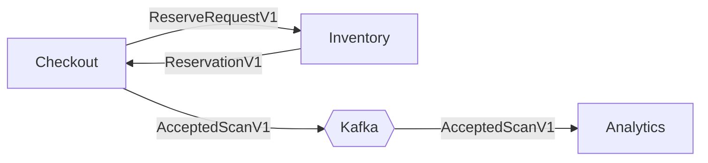

| Class / record | Brief responsibility |
|---|---|
| `ReserveRequestV1` | Reservation command body: transaction ID and requested lines. |
| `ReserveLineV1` | One SKU and requested quantity. |
| `ReservationV1` | Inventory’s persisted outcome and granted lines. |
| `AcceptedScanV1` | Kafka event for one accepted scan; has `eventId` for deduplication. |

- `v1` packages allow a later breaking `v2` without immediate upgrades.
- `@JsonIgnoreProperties(ignoreUnknown = true)` lets older readers tolerate added fields.

---


# API Gateway: Public Routing

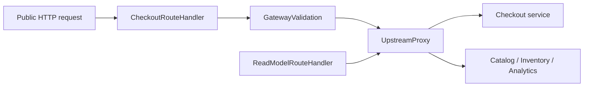

| Class | Brief responsibility |
|---|---|
| `CheckoutRouteHandler` | Routes start, scan, get, and complete transaction requests to Checkout. |
| `ReadModelRouteHandler` | Routes catalog, low-stock, and popular-items reads to their owners. |
| `GatewayValidation` | Performs only legacy required-field checks, such as missing `sku`. |
| `UpstreamProxy` | Sends the request upstream and relays its response. |

- The gateway has routing and compatibility validation, not checkout business rules.

---

# API Gateway: `UpstreamProxy`

| Behavior | Why it matters |
|---|---|
| Preserves upstream status, body, and content type | Domain errors such as `409 INSUFFICIENT_STOCK` reach the station. |
| Uses an 8-second gateway timeout | Checkout’s 5-second completion deadline can return its own result first. |
| Converts connection/refusal/timeout failures to `503 SERVICE_UNAVAILABLE` | Separates unavailable services from valid domain errors. |
| Has no datasource, Kafka client, or `/internal/**` route | Keeps gateway from becoming a hidden domain owner. |

**Class to open:** `UpstreamProxy` — generic HTTP forwarding and response translation.

- Show one scan route calling `proxy.forward(...)`, then a preserved 4xx response.

---

# Catalog Service and Local Projections

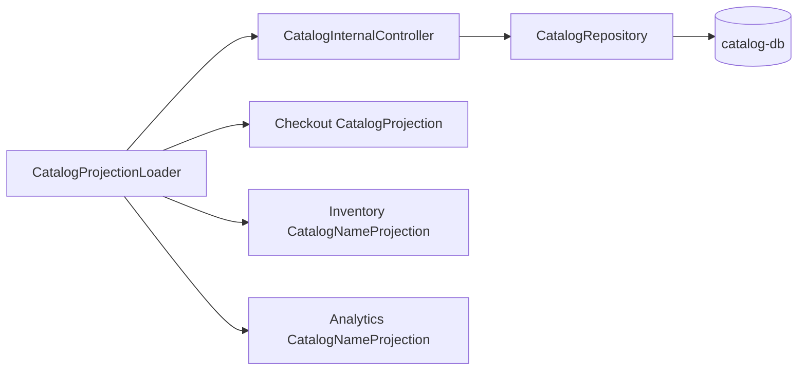

| Class | Brief responsibility |
|---|---|
| `CatalogInternalController` | Exposes internal, read-only catalog version and paged-product endpoints. |
| `CatalogRepository` | Reads Catalog’s own products from its database. |
| `CatalogProjectionLoader` | Polls catalog version and refreshes a consumer’s local copy. |
| `CatalogProjection` | Checkout’s local name-and-price lookup copy. |
| `CatalogNameProjection` | Inventory/Analytics local SKU-to-name copy. |

- Explain `CURRENT`, `STALE`, and `EMPTY`: freshness changes fallback behavior, not ownership.

---

# Scan Path: Resolve a Product Before Locking

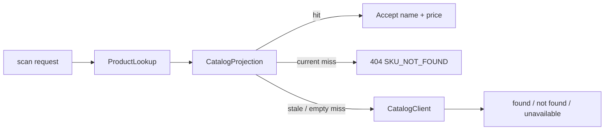

| Class | Brief responsibility |
|---|---|
| `ProductLookup` | Resolves a scanned SKU to the captured name and price. |
| `CatalogProjection` | Serves local product lookups without a remote call. |
| `CatalogClient` | Fallback reader for Catalog’s internal API when a local miss is untrustworthy. |

- A current projection miss is a real `404`; stale/empty misses must be verified remotely.
- This happens before Checkout opens a transaction, so network waiting never holds a row lock.

---

# Scan Path: One Local Checkout Transaction

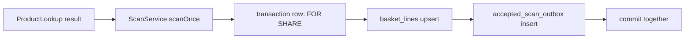

| Class | Brief responsibility |
|---|---|
| `ScanService` | Adds a validated scan to the basket in one short local transaction. |
| `ApiException` | Converts missing, closed, or busy transactions into domain HTTP errors. |
| `UuidV7` | Creates time-ordered unique IDs for accepted-scan events. |

- Shared lock serializes with completion freeze; scan enters the frozen basket or sees `409 TRANSACTION_BUSY`.
- First scan captures price/name; later scans increase quantity without repricing.
- Basket change and outbox row commit together. Scanning does not reserve stock.

---

# Completion: Saga Overview

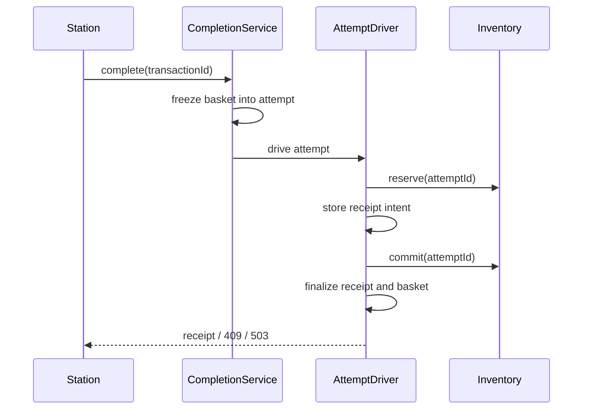

- Five short local transactions span two private databases; there is no distributed database transaction.
- Inventory commands use `attemptId`, so retries are safe.
- Partial stock is intentional: granted units are bought; remaining units stay in the basket.

---

# Completion: Attempt State Machine

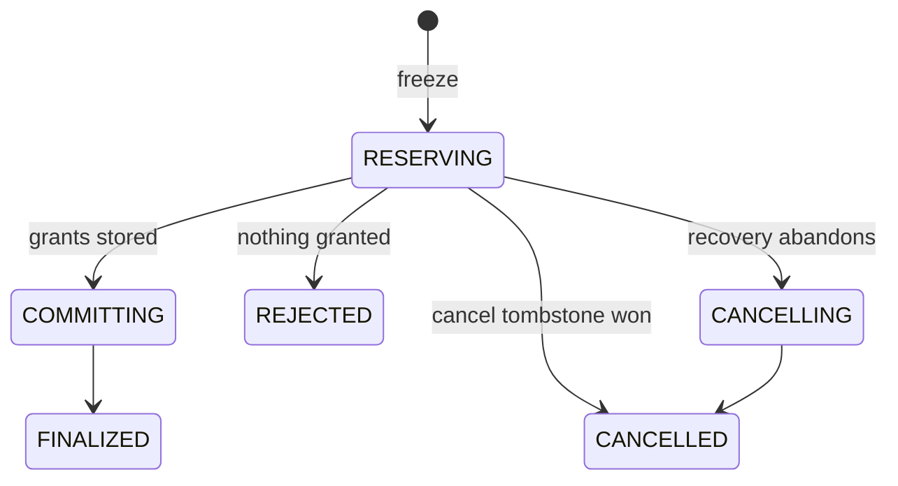

| Class | Brief responsibility |
|---|---|
| `AttemptState` | Defines durable states a completion attempt may occupy. |
| `CompletionAttemptRepository` | Persists attempts, frozen lines, leases, state changes, and receipt data. |
| `ReceiptAssembler` | Builds an exact-cents receipt for units bought by this attempt. |

- `COMMITTING` is the point of no return: it only moves forward to `FINALIZED`.
- `REJECTED` means Inventory answered successfully but granted nothing. It returns `409 INSUFFICIENT_STOCK` and leaves the basket unchanged.

<!--
This slide separates a business outcome from a technical failure. Do not say that REJECTED is retried.

REJECTED is terminal. Inventory was reachable and answered that it could not reserve even one requested unit. Checkout records zero grants, clears the active attempt, returns 409 INSUFFICIENT_STOCK, and leaves the whole basket open and unchanged. A later completion request creates a fresh attempt and may succeed if stock has changed.

Retries apply to an unknown outcome such as an Inventory timeout or temporary outage. The AttemptDriver repeats the same idempotent command while the request deadline remains. After the request deadline, RecoveryWorker continues retrying from the durable attempt. Only a long-unresolved RESERVING attempt can later move to CANCELLING; COMMITTING never cancels.
-->

---

# Completion: Who Calls Whom

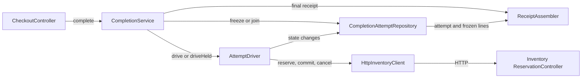

| Class | What it does in completion |
|---|---|
| `CheckoutController` | Receives the public `complete` request and calls the service. |
| `CompletionService` | Freezes or joins the basket, starts the driver, then chooses receipt, 409, or 503. |
| `AttemptDriver` | Runs the next durable saga step and handles retryable failures. |
| `HttpInventoryClient` | Sends idempotent reserve, commit, and cancel requests to Inventory. |
| `CompletionAttemptRepository` | Stores the attempt, frozen lines, lease, state, and finalized receipt data. |

- The controller does not coordinate the saga. `CompletionService` and `AttemptDriver` do.
- Inventory never reaches into Checkout's database. It receives only HTTP commands containing `attemptId`.

<!--
Walk the arrows left to right.

CheckoutController is deliberately thin: it passes the public completion request to CompletionService. CompletionService owns the first local transaction. It either freezes a new basket snapshot or joins the attempt created by an earlier duplicate request.

Then it calls AttemptDriver. The driver reads the durable state and makes one of three idempotent Inventory calls: reserve, commit, or cancel. The driver writes every state transition through CompletionAttemptRepository, so a later request or recovery worker can continue from the saved state.

When the attempt is finalized, ReceiptAssembler builds the public receipt from the data recorded for that exact attempt. The important boundary is that Inventory receives HTTP commands only; it never reads Checkout tables.
-->

---

# Completion: Freeze or Join

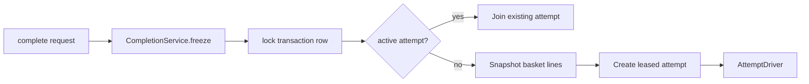

| Class | Brief responsibility |
|---|---|
| `CompletionService` | Freezes a basket once, joins duplicate completion, then starts the driver. |
| `CompletionAttemptRepository.TransactionLock` | Represents locked transaction state used during freeze. |
| `UuidV7` | Generates the completion attempt ID. |

- A duplicate click/retry joins the active attempt instead of buying twice.
- Freeze rejects missing, non-open, and empty transactions; saga driving occurs outside the transaction.

---

# Completion: `AttemptDriver`

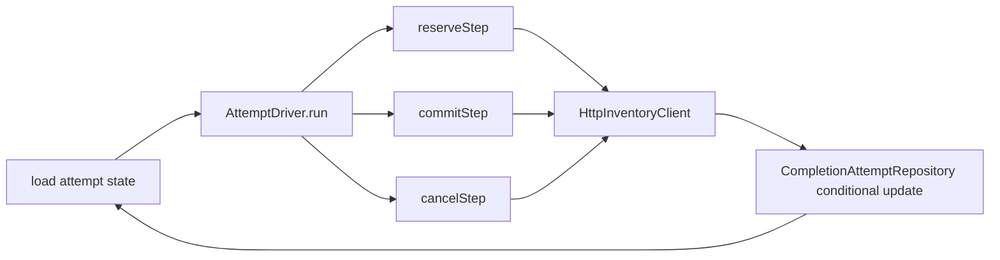

| Class | Brief responsibility |
|---|---|
| `AttemptDriver` | Advances one attempt safely until terminal state or request deadline. |
| `HttpInventoryClient` | Calls Inventory reserve/commit/cancel with bounded connection/read timeouts. |
| `CompletionAttemptRepository` | Uses expected-state writes so only one driver advances a step. |
| `ReceiptAssembler` | Produces the response receipt for this exact attempt. |

- Unknown Inventory outcome is never treated as cancellation: record failure, return `503`, and retry later.

---

# Inventory: Reserve Without Long Hot-Row Locks

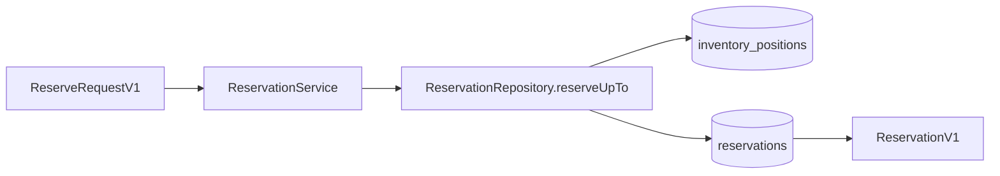

| Class | Brief responsibility |
|---|---|
| `ReservationService` | Coordinates idempotent reserve, commit, and cancel commands. |
| `ReservationRepository` | Runs atomic SQL updates for positions and reservation records. |
| `ReservationRepository.reserveUpTo` | Grants up to available quantity for one SKU in one update. |

- `available = physical_stock - reserved_stock`; reserve adds only the granted quantity to `reserved_stock`.
- Atomic update avoids a read-then-write race and avoids a long `FOR UPDATE` lock.
- Consistent SKU order and lock retries handle contention.

---

# Inventory: Idempotent Commands and Sale Application

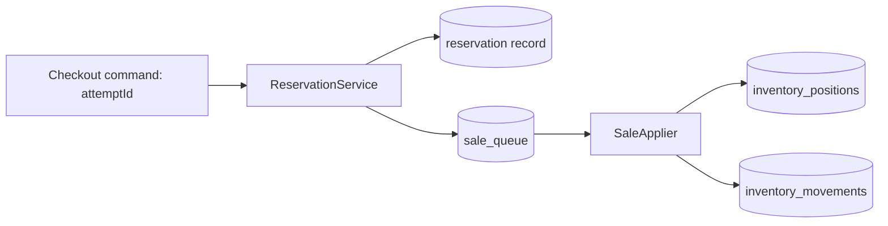

| Class | Brief responsibility |
|---|---|
| `ReservationService` | Returns stored outcome for repeated reserve/commit/cancel commands. |
| `SaleApplier` | Batches committed sale queue rows into physical-stock and movement updates. |
| `withLockRetries` | Retries deadlock/lock-wait victims around short inventory work. |

- Reusing an `attemptId` with different lines is `RESERVATION_MISMATCH`.
- Cancel on an unknown ID writes a tombstone, preventing a late reserve from holding stock.
- `SaleApplier` groups hot-SKU changes, so many completions take one position-row lock per batch.

---

# Recovery: `RecoveryWorker`

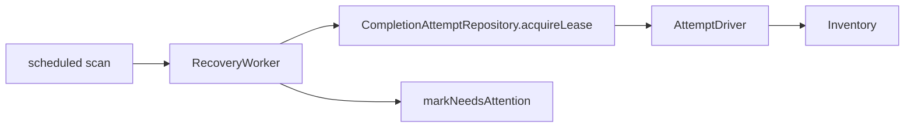

| Class | Brief responsibility |
|---|---|
| `RecoveryWorker` | Finds non-terminal attempts and resumes safe saga steps after timeout/crash. |
| `CompletionAttemptRepository.acquireLease` | Ensures only one request, worker, or replica drives an attempt. |
| `RecoveryLifecycle` | Stops new recovery work and releases leases cleanly at shutdown. |
| `AttemptDriver` | Reuses the same transition logic for request and recovery. |

- Only an old failing `RESERVING` attempt may be abandoned; `COMMITTING` must keep moving forward.
- `needs_attention` signals operators but does not silently stop retries.

---


# Accepted Scans: Transactional Outbox to Kafka

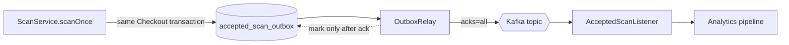

| Class | Brief responsibility |
|---|---|
| `OutboxRelay` | Reads unpublished scans, publishes to Kafka, then records acknowledgements. |
| `OutboxHealthIndicator` | Reports pending outbox rows as health detail. |
| `AcceptedScanListener` | Receives Kafka batches and begins Analytics processing. |

- Kafka down means scans commit locally; rows wait in Checkout’s outbox.
- Crash after Kafka acknowledgement may duplicate an event; stable `eventId` makes it safe downstream.

---


# Analytics Pipeline: Pipes and Filters

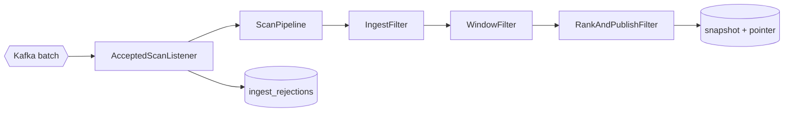

| Class | Brief responsibility |
|---|---|
| `AcceptedScanListener` | Validates a consumed batch and acknowledges only after database commit. |
| `ScanPipeline` | Connects ingestion, windowing, and ranking filters in one flow. |
| `KafkaConsumerConfig` | Seeks/redelivers a failed batch instead of acknowledging it early. |

- All filters run in one Analytics transaction; events too new/unreadable go to rejections.

---

# Analytics Pipeline: Three Filters

| Class | Brief responsibility | Correctness point |
|---|---|---|
| `IngestFilter` | Deduplicates `eventId`s and assigns new scans a canonical sequence. | Replay changes nothing. |
| `WindowFilter` | Selects latest 1,000 scans and opens a window every 500 scans. | Windows come from deterministic sequence numbers. |
| `RankAndPublishFilter` | Counts/ranks SKUs, writes snapshot rows, then moves the pointer. | Readers never see half a ranking. |

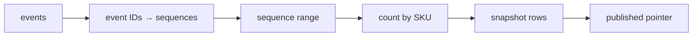

- Ties rank by count then SKU; missing catalog names fail/retry rather than publish ambiguous items.

---


# Data Ownership in Code

| Area | What to show |
|---|---|
| Flyway migrations | Each service has its own `src/main/resources/db/migration` history. |
| private-store migrations | Old cross-store views/procedures are explicitly removed. |
| readiness | Each service becomes ready using only its own database. |
| dependency health | Inventory/Kafka/projection freshness is detail, not readiness. |
| error model | Each service owns `ApiError`, `ApiException`, and `ApiExceptionHandler`. |


- A service can be deployable/ready while a collaborator is temporarily unavailable.

---


# Questions


