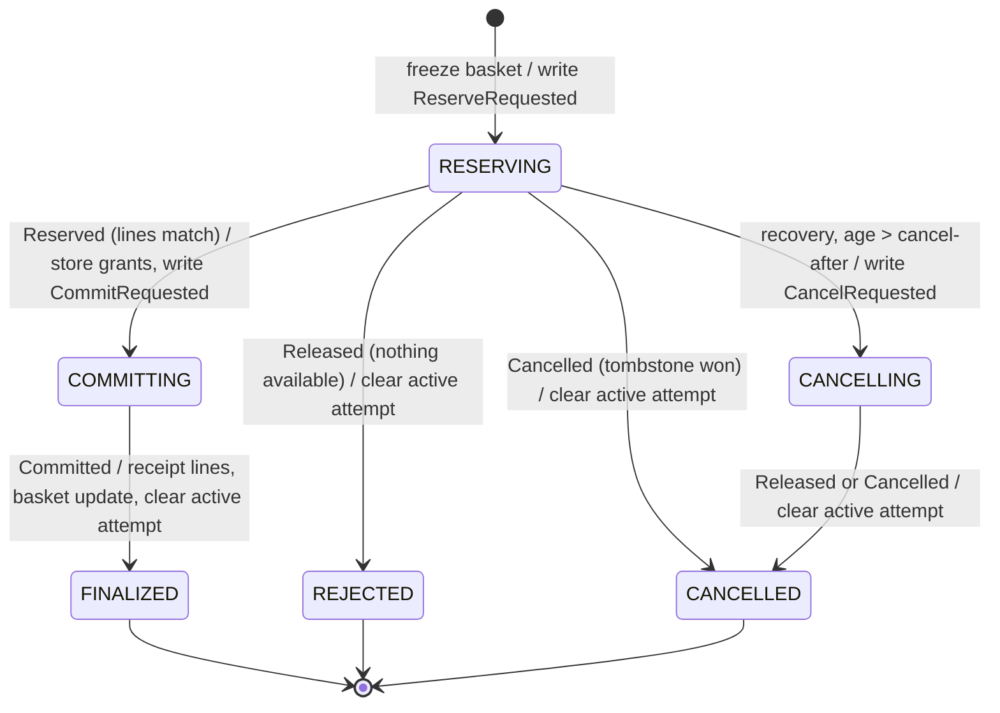

# Data Model: Event-Driven Communication Between Checkout Microservices

Phase 1 design for [plan.md](plan.md). Only what changes relative to the
[004 data model](../004-domain-services/data-model.md) is described here. Baskets, receipts,
reservations, positions, movements, the sale queue, ingested scans, and snapshots keep their
004 definitions and invariants. Message shapes are in [contracts/](contracts/README.md).

## Changes per owner database

### Catalog (`catalog-db`), migration `V4__catalog_publication.sql`

| Table | Column | Type | Rule |
|---|---|---|---|
| `catalog_publication` (new, single row `id = 1`) | `published_version` | `BIGINT NULL` | Last `catalog_metadata.catalog_version` whose every item was acknowledged by the broker. NULL = never published |
| | `published_at` | `TIMESTAMP(6) NULL` | When that version finished publishing |

Invariant: `published_version ≤ catalog_metadata.catalog_version`. Publication is pending
exactly while `published_version` is NULL or less than `catalog_version` (research R2).

### Checkout (`checkout-db`), migration `V7__messaging.sql`

| Table | Column | Type | Rule |
|---|---|---|---|
| `command_outbox` (new) | `outbox_id` | `BIGINT AUTO_INCREMENT` PK | Send order within this database |
| | `message_id` | `CHAR(36)` UNIQUE | UUIDv7. Each send of a command, including recovery resends, is a new row with a new ID |
| | `attempt_id` | `VARCHAR(64)` | Kafka key and `correlationId` |
| | `message_type` | `VARCHAR(32)` | `ReserveRequested` \| `CommitRequested` \| `CancelRequested` |
| | `payload` | `JSON` | Body as specified in the contract |
| | `created_at` | `TIMESTAMP(6)` | Commit time of the transition that wrote it |
| | `published_at` | `TIMESTAMP(6) NULL` | Set only after broker acknowledgment |
| | index | `(published_at, outbox_id)` | Sweeper selects `published_at IS NULL AND created_at < now − 2 s` |
| `completion_attempts` (changed) | `last_command_at` | `TIMESTAMP(6) NOT NULL` | Time the current state's command was last written. Drives resends |
| | `command_sends` | `INT NOT NULL DEFAULT 1` | Sends of the current state's command. Reset to 1 on each transition |
| | `step_failures`, `lease_owner`, `lease_until` | dropped | No driver holds an attempt now; resend claims use `next_retry_at` (below) |
| `projection_state` (changed) | `topic_offset` | `BIGINT NULL` | Offset of the last applied `catalog.products.v1` record. NULL = replay from the beginning |
| | `last_verified_at` | dropped | The 004 staleness probe is gone (research R3) |
| `catalog_projection` | — | unchanged | `catalog_version` = version of the event that last wrote the row |

`accepted_scan_outbox` and its relay are unchanged.

### Inventory (`inventory-db`), migration `V9__messaging.sql`

| Table | Column | Type | Rule |
|---|---|---|---|
| `reply_outbox` (new) | `outbox_id`, `message_id`, `attempt_id`, `message_type`, `payload`, `created_at`, `published_at` | as `command_outbox` | `message_type` ∈ `Reserved` \| `Committed` \| `Released` \| `Cancelled` \| `Conflict` |
| | `causation_id` | `CHAR(36)` | `messageId` of the command this reply answers |
| `projection_state` (changed) | `topic_offset` added, `last_verified_at` dropped | | As Checkout |

Invariant: every `reply_outbox` row commits in the same transaction as the reservation change it
reports. A repeated command writes a new reply row with the same stored state.

### Analytics (`analytics-db`), migration `V5__projection_offset.sql`

`projection_state.topic_offset` is added and `last_verified_at` is dropped, as in Inventory.
Ingest tables are unchanged.

## Completion attempt state machine (message-driven)

States are as in 004. What changes is what moves the attempt from one state to the next: a
reply listener transaction instead of a driver loop.



Rules:
1. **One transaction per transition**: each transition is a single conditional
   `UPDATE … WHERE attempt_id = ? AND state = ?`, plus its side writes and its outbox row. Zero
   rows updated means a stale or duplicate reply, which is ignored.
2. **Forward only after `COMMITTING`**: `COMMITTING` never moves to `CANCELLING`, and recovery
   only resends `CommitRequested`.
3. **Resend claim**: the recovery sweep runs every 1 s. It claims attempts where `state` is
   non-terminal, `needs_attention = false`, and `next_retry_at ≤ now`, using
   `UPDATE … SET next_retry_at = now + backoff(command_sends), command_sends = command_sends + 1,
   last_command_at = now WHERE … AND next_retry_at = ?`. It writes the current state's command
   again in the same transaction. The backoff is 250 ms doubling to a 5 s cap (004 R9).
   `next_retry_at` is set to `now + 1 s` by each transition, so a healthy saga never triggers a
   resend.
4. **Attention**: `command_sends > attention-after` (20) sets `needs_attention`, and resending
   stops. The operator endpoint from 004 (`POST …/completion-attempts/{id}/retry`) clears it and
   resets `next_retry_at`.
5. **Unexpected replies**: a `Conflict` reply, or a `Reserved` whose lines don't match the
   frozen snapshot, parks the attempt (`needs_attention`, `last_error`) without a transition.

## Reservation state (Inventory), unchanged

`RESERVED → COMMITTED | RELEASED`, plus a `CANCELLED` tombstone for an unknown ID, as in 004.
The only change is the entry point: commands arrive from `inventory.commands.v1`, and every
outcome produces one reply.

| Command | Stored state before | Reply |
|---|---|---|
| `ReserveRequested` | none | `Reserved` (some units held) or `Released` (none available) |
| `ReserveRequested` | any | Reply for the stored state (repeat) |
| `CommitRequested` | `RESERVED` | `Committed` |
| `CommitRequested` | `COMMITTED` | `Committed` (repeat) |
| `CommitRequested` | none, `RELEASED`, or `CANCELLED` | `Conflict` (`RESERVATION_NOT_FOUND` / `RESERVATION_NOT_COMMITTABLE`) |
| `CancelRequested` | `RESERVED` | `Released` |
| `CancelRequested` | none | `Cancelled` (tombstone written) |
| `CancelRequested` | `RELEASED` / `CANCELLED` | Same state (repeat) |
| `CancelRequested` | `COMMITTED` | `Conflict` (`RESERVATION_COMMITTED`) |

## Happy-path message flow

```mermaid
sequenceDiagram
    participant C as Client
    participant G as Gateway
    participant CO as Checkout
    participant K as Kafka
    participant IN as Inventory
    C->>G: POST /transactions/{id}/complete
    G->>CO: forward (HTTP, single owner)
    CO->>CO: tx: freeze, attempt RESERVING, outbox ReserveRequested
    CO->>K: inventory.commands.v1 ReserveRequested (after commit)
    K->>IN: ReserveRequested
    IN->>IN: tx: reserve lines, reply_outbox Reserved
    IN->>K: inventory.replies.v1 Reserved
    K->>CO: Reserved
    CO->>CO: tx: COMMITTING + grants, outbox CommitRequested
    CO->>K: CommitRequested
    K->>IN: CommitRequested
    IN->>IN: tx: COMMITTED, sale_queue, reply_outbox Committed
    IN->>K: Committed
    K->>CO: Committed
    CO->>CO: tx: FINALIZED, receipt, basket; complete waiter
    CO-->>G: 200 receipt
    G-->>C: 200 receipt
```

## Catalog projection lifecycle (each consumer)

| State | Condition | Readiness |
|---|---|---|
| `REPLAYING` | `topic_offset` is NULL or below the end offset captured at assignment | `OUT_OF_SERVICE` |
| `CURRENT` | Caught up to the captured end offset and at least one product held | `UP` |
| `LAGGING` | Was `CURRENT`, and new records are not yet applied | `UP`, with lag exposed as gauge `catalog.projection.lag` |

A rebuild sets `topic_offset = NULL` and deletes the rows in one transaction, then reseeks to the
beginning. The service is `REPLAYING` until it catches up.

## Reconciliation additions

`reconcile.sh` keeps the 004 checks: for each SKU, starting stock minus ending stock equals
purchased receipt quantities, and no unresolved attempts or leftover reservations remain. It adds:
- unsent rows in `command_outbox`, `reply_outbox`, and `accepted_scan_outbox`: expected 0 after
  the run settles
- records in each dead-letter topic: expected 0 outside the poison-message test
- `catalog_publication.published_version = catalog_metadata.catalog_version`
- each consumer's `projection_state.catalog_version` equal to that version
